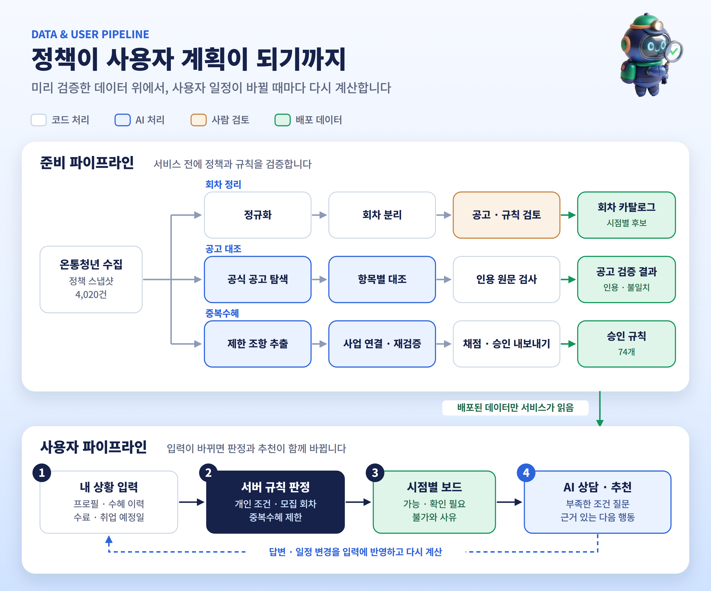
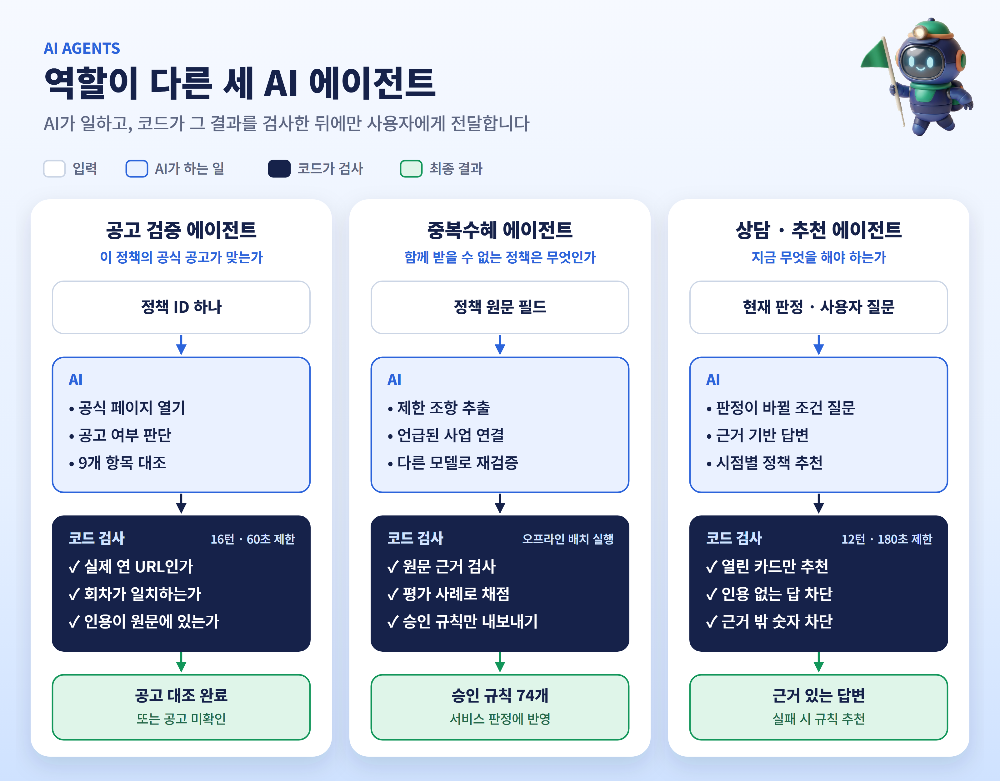
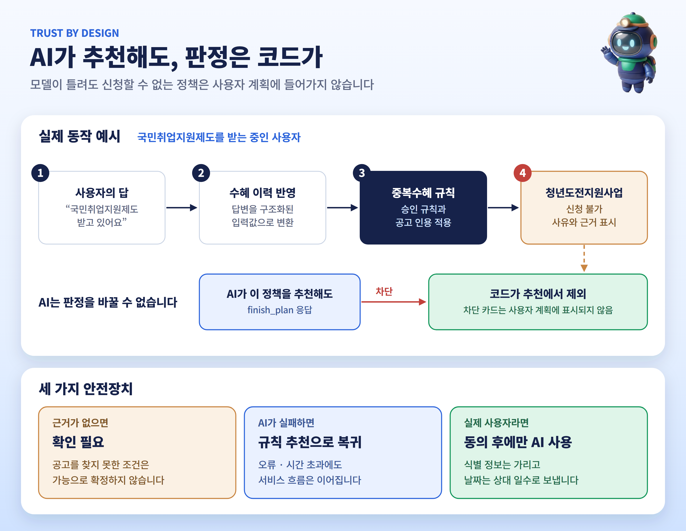
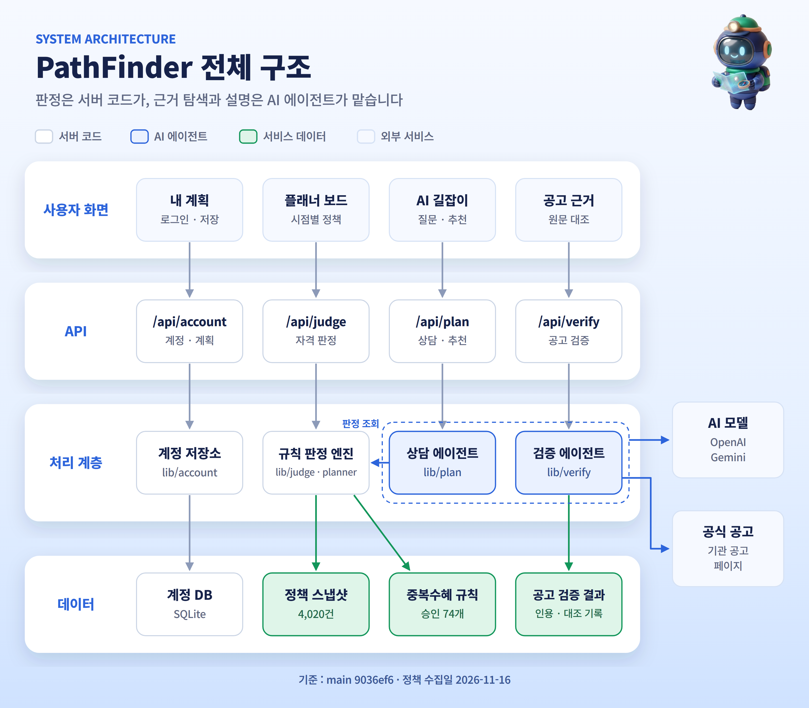

<div align="center">


# PathFinder

### 졸업 다음 달, 나는 무엇을 받을 수 있을까?

**수료 · 취업 · 이사 같은 내 일정을 넣으면,<br />시점마다 신청할 수 있는 청년 정책과 그 근거를 보여 주는 AI 정책 길잡이**

[](https://path-finder-flax-alpha.vercel.app/app)
<!-- TODO: 시연 영상 업로드 후 아래 줄의 주석을 풀고 링크 입력
[](영상_URL)
-->


<sub>2026 대한민국 청년 CAREER FAIR AI 해커톤 출품작</sub>

</div>

<!-- TODO: 시연 GIF 추가. 추천 장면 = 이사 일정을 넣자 보드의 열과 신청 가능 여부가 바뀌는 10초
<p align="center"></p>
-->

> **AI가 자격을 판단하지 않습니다.**
> 코드가 판정하고, AI는 공식 근거를 찾아 설명하며, 근거가 없으면 "확인 필요"로 남깁니다.

<br />

## 왜 만들었나요

직업훈련 수료를 앞둔 청년은 수료 뒤 구직을 이어가거나 첫 일자리에 들어갈 때, 알아 둔 지원을 **언제** 신청할 수 있는지 다시 판단해야 합니다.

정책마다 자격을 보는 **기준 시점**이 다르기 때문입니다.

| 정책 | 자격을 보는 시점 | 사용자가 판단할 것 |
|---|---|---|
| 경기청년 역량강화 기회지원 | 취업 여부는 **시험 응시일** 기준 | 취업 전에 본 시험이면 입사 후에도 검토 가능 |
| K-뉴딜 아카데미 | 참여 제한은 **신청일** 기준, 개시 전 해소 시 증빙 검토 | 수료 예정일이 프로그램 개시일보다 빠른가 |
| 청년도전지원사업 | 국민취업지원제도 **수혜 중 · 종료 후 기간**과 공고별 유형 | 내 종료일과 회차 · 유형이 맞는가 |

결국 사용자는 자신의 수료일, 입사일, 참여 이력을 공고마다 직접 대조해야 합니다.

이 과정에서 아직 신청할 수 있는 지원을 스스로 포기하거나, 조건을 놓친 채 신청했다가 절차를 다시 밟을 수 있습니다.

정부도 2026년 청년 종합투자 추진전략에서 개별 사업 중심 전달로 청년이 필요한 지원을 [적시에 찾고 활용하기 어렵다](https://www.moel.go.kr/news/enews/report/enewsView.do?news_seq=19843)는 문제를 짚었습니다.

대한상공회의소의 2023년 청년 구직자 300명 조사에서도 일자리 지원정책에 참여하지 않은 이유 1위는 [정보 탐색의 어려움과 선정 어려움에 대한 인식(각 29.2%)](https://kbcci.korcham.net/front/boardlink/boardlinkContentsView.do?boardId=13&contId=20120936354&menuId=5109)이었습니다.

<br />

## 무엇이 다른가요

기존 서비스는 **"지금 내가 받을 수 있는 정책"** 을 찾는 데 강합니다.

PathFinder는 여기에 **시간**을 더해 **"내 일정이 바뀌면 무엇이 열리고 닫히는가"** 에 답합니다.

| 기존 서비스가 잘하는 것 | PathFinder가 더하는 것 |
|---|---|
| [온통청년](https://www.youthcenter.go.kr/youthPolicy/ythPlcyTotalSearch) : 정책 검색 · 비교 · AI 추천 · 자격 진단 | 수료 · 취업 · 이사 **예정일까지 반영한 시점별 판정** |
| [혜택알리미](https://openservice.go.kr/walletBenefitNoti) : 실제 상태 변화에 따른 혜택 안내 | 변화가 일어나기 **전에** 결과를 미리 비교 |
| 정책별 공고 마감일 안내 | 공고 마감과 다른 **내 개인 기한** 계산 |

**예시.** K-뉴딜 아카데미의 공고 마감은 12월 31일이지만, 12월 19일에 수료하는 사용자의 현재 시점 신청 구간은 **12월 18일까지**로 계산됩니다. 수강 중 제한이 프로그램 개시일 전에 해소되는지는 단정하지 않고 **확인 필요**로 안내합니다.

<br />

## 핵심 기능

| | 기능 | 사용자가 얻는 것 |
|:---:|---|---|
| 🗓️ | **시점별 정책 보드** | 현재 · 수료 후 · 취업 후 · 이사 후로 나뉜 신청 가능 정책 |
| ⏰ | **내 기한 계산** | 공고 마감이 아닌 내 일정 기준의 실제 신청 기한 |
| 🔍 | **공고 근거 확인** | 판단에 쓰인 공식 공고 문장과 대조 결과 |
| 🚫 | **중복수혜 확인** | 함께 받을 수 없는 정책과 그 이유 |
| 🤖 | **AI 길잡이** | 판정을 바꾸는 조건만 묻는 질문과 시점별 추천 경로 |
| 🧭 | **계획 저장 · 비교 · 로드맵** | 여러 계획을 비교하고 날짜 위에서 확인 |

<br />

## 어떻게 동작하나요

미리 검증한 데이터 위에서, 사용자의 일정이 바뀔 때마다 다시 계산합니다.

<p align="center"></p>

<br />

## AI를 어떻게 썼나요

정책 자격은 틀리면 사용자가 실제 기회를 잃는 영역입니다.

그래서 **정해진 규칙으로 계산할 수 있는 판정은 코드에**, **비정형 공고를 읽고 사람의 말로 풀어야 하는 일은 AI에** 맡겼습니다.

<p align="center"></p>

| 에이전트 | AI가 필요한 이유 | 실행 시점 |
|---|---|---|
| **공고 검증** | 기관마다 다른 형식의 공고에서 해당 회차와 조건을 찾아야 함 | 정책 검증 요청 시 |
| **중복수혜** | 정책 원문에 자연어로 흩어진 제한 조항을 구조화해야 함 | 배포 전 배치 |
| **상담 · 추천** | 사용자의 말을 이해하고 판정 결과를 쉽게 설명해야 함 | 사용자 요청 시 |

<br />

## AI를 어떻게 믿을 수 있나요

모델이 틀려도 **신청할 수 없는 정책은 사용자 계획에 들어가지 않습니다.**

<p align="center"></p>

- **판정 분리** : AI의 추천은 서버가 계산한 카드 안에서만 채택되고, 차단된 카드는 버립니다.
- **근거 강제** : 인용이 없는 답변과 전달한 자료에 없는 숫자는 사용자에게 보여 주지 않습니다.
- **안전한 실패** : 모델 오류나 시간 초과가 나면 규칙 기반 추천으로 돌아갑니다.
- **개인정보 최소화** : 실제 사용자는 동의한 뒤에만 AI를 쓰고, 식별 정보는 가리며 날짜는 상대 일수로 보냅니다.

<br />

## 시스템 구조

<p align="center"></p>

| 영역 | 기술 | 선택 이유 |
|---|---|---|
| 웹 · API | Next.js 15, React 19, TypeScript | 화면과 서버 판정을 하나의 타입 체계로 관리 |
| 입력 검증 | Zod | 사용자 입력과 AI 응답을 같은 방식으로 검사 |
| 데이터 | JSON 배포본, SQLite | 검증한 규칙을 버전으로 고정해 같은 입력에 같은 판정 보장 |
| AI | OpenAI, Gemini | 작업별로 공급자와 모델을 환경변수로 교체 |
| 품질 | Vitest, ESLint | 판정 · 에이전트 안전장치를 회귀 테스트로 보호 |
| 배포 | Vercel (서울 리전) | 국내 사용자 기준의 응답 경로 |

<details>
<summary><b>폴더 구조</b></summary>

```text
.
├─ app/        # 화면과 API 라우트
├─ lib/
│  ├─ judge/   # 규칙 판정 엔진
│  ├─ planner/ # 시점별 평가와 플래너 상태
│  ├─ route/   # 타임라인과 로드맵
│  ├─ verify/  # 공고 검증 에이전트
│  ├─ plan/    # 상담 · 추천 에이전트
│  ├─ ai/      # AI 공급자 어댑터
│  ├─ db/      # 규칙 적재와 배포본 내보내기
│  └─ account/ # 계정 · 계획 · 알림
├─ data/       # 정책 스냅샷과 승인 규칙
├─ scripts/    # 데이터 수집 · 중복수혜 분석 · 평가
├─ tests/      # 단위 · 통합 테스트
└─ docs/       # 설계와 운영 문서
```

</details>

<br />

## 숫자로 보는 프로토타입

<div align="center">

| **4,020건** | **74개** | **3종** |
|:---:|:---:|:---:|
| 수집한 청년 정책 | 승인된 중복수혜 규칙 | 역할이 분리된 AI 에이전트 |

<sub>정책 데이터 기준일 2026-11-16</sub>

</div>

<br />

## 현재 범위와 본선 계획

이번 프로토타입은 **"내 일정에 따라 바뀌는 정책 판단"** 의 전체 흐름을 끝까지 시연하는 데 집중했습니다.

| 영역 | 우리가 만들려는 모습 | 현재 프로토타입 | 본선 고도화 |
|---|---|---|---|
| 공고 대조 | 모든 추천에 공식 원문 근거 | 정책별 탐색과 인용 검사 구현, 저장된 대조 기록 6건 | 상위 모델과 탐색 고도화로 공고 발견률 향상 |
| 중복수혜 | 신청 전에 정책 간 충돌 발견 | 승인 규칙 74개 적용 | 규칙 범위 확대와 검토 자동화 |
| 상담 · 추천 | 내 상황에 맞는 다음 행동 안내 | 판정 안에서 질문 · 답변 · 추천 | 상위 모델로 대화와 추천 품질 개선 |
| 정책 데이터 | 항상 최신 공고 기준 | 2026-11-16 기준 고정 | 자동 수집과 변경 감지 |
| 계정 · 알림 | 계획 저장과 마감 전 알림 | 프로토타입용 SQLite | 운영 DB와 실제 알림 발송 |

**활용 시나리오.** 직업훈련기관의 수료 상담 전에 훈련생이 PathFinder로 자신의 일정별 정책과 확인할 질문을 정리하면, 상담 시간을 실제 진로 판단에 쓸 수 있습니다.

> PathFinder는 신청 판단을 돕는 프로토타입입니다. 최종 자격과 선정 여부는 각 기관의 공고와 담당 기관의 확인을 따릅니다.

<br />

## 출처와 AI 활용 고지

| 구분 | 이름 | 사용 위치 |
|---|---|---|
| 공공 데이터 | [온통청년 청년정책 API](https://www.youthcenter.go.kr/) (한국고용정보원) | 정책 스냅샷 |
| 공식 자료 | 고용24, 정부24, 지자체 · 기관 공고 | 공고 대조와 근거 인용 |
| 서비스 AI | OpenAI API, Gemini API | 상담 · 추천, 공고 검증, 중복수혜 분석 |
| 개발 AI 도구 | Claude Code, Codex | 조사, 설계, 구현, 검증 보조 |
| 오픈소스 | Next.js, React, Zod, Vitest, tsx (MIT) | 웹 앱, 입력 검증, 테스트 |

저장된 공고 대조 기록 6건은 개발 도구가 탐색 경로를 정하고, 서비스의 검증 코드가 페이지 접근과 인용을 대조해 만든 기록입니다.

<!-- TODO: 로봇 캐릭터 이미지의 제작 도구와 저작권, 저장소 LICENSE를 대회 규정 확인 후 기재 -->
