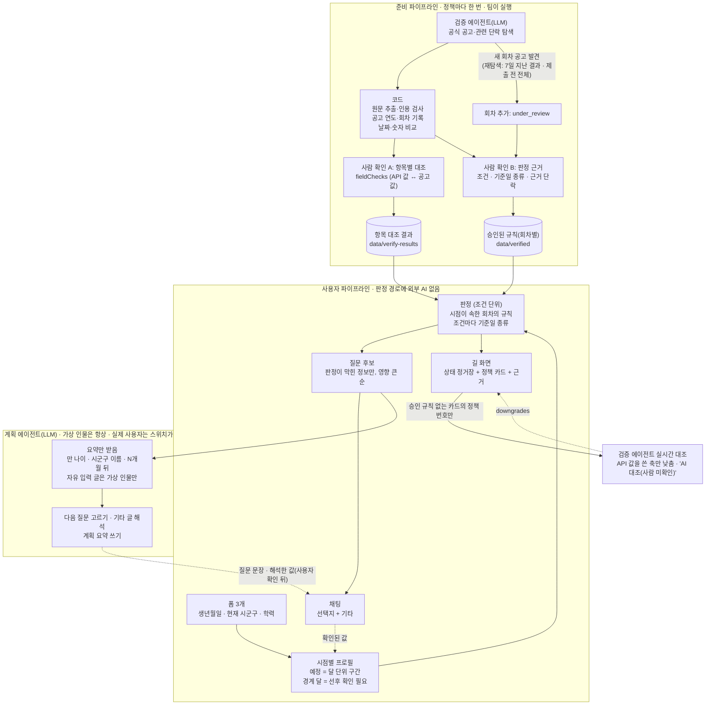

# PathFinder 통합 설계

작성일 2026-11-18 · 제출 2026-11-23 12시 · 상태: 2판 · 팀 상의 반영(구현 전)

- **뼈대:** 구조 개선 계획 3판 (`docs/2026-11-18-structure-revision-plan.md`)
- **합친 문서:** AI 에이전트 구체화 (`2026-11-18-ai-agents-design.md`, 이하 "에이전트 설계")
- **이전 설계:** `docs/2026-11-16-policy-twin-design.md`. 이 문서와 다른 부분은 이 문서를 따른다.

**2판 (11/18 팀 상의 반영):** 승인된 규칙은 API 대조로 낮추지 않음(5.3), 새 회차는 "공고 기준 확인 중"(5.4), 캐시 키는 정책 번호 + 수정일 · 근거는 회차별 보존(4.4), 실제 사용자의 자유 입력은 외부 AI로 보내지 않음(6.2), 이사 예정은 범위에 넣되 가장 먼저 빼는 작업(5.1, 11장).

표시: `[결정]` 이미 정해진 것 · `[제안]` 이 문서에서 정한 것, 이견이 있으면 말해 주세요 · `[변경 가능]` 나중에 바뀔 수 있음

---

## 1. 한 줄 요약

**사용자에게 보여주는 판정이 어떤 근거에서 나왔는지 끝까지 추적할 수 있게 한다.** AI는 두 곳에서 일한다. ① 준비 단계에서 공식 공고를 찾아 사람이 확인할 근거를 만들고, ② 사용자 단계에서는 (허용된 범위에서) 계획을 대화로 묻고 정리한다. 자격 판정은 언제나 코드가 한다.

| 단계 | 누가 | 다음 단계에 넘기는 것 |
|---|---|---|
| 공고 탐색 | 검증 에이전트 | 공식 공고와 관련 단락, API 값과의 항목별 대조 |
| 근거 확인 | 사람 | 조건·기준일·예외 (승인된 규칙), 항목별 대조 확인 |
| 판정 | 코드 | 승인된 규칙을 사용자 계획의 각 시점에 적용한 결과 + 쓴 근거 |
| 계획 대화 | 계획 에이전트 | 다음 질문, 직접 입력한 답의 해석, 계획 요약 (판정은 하지 않음) |

**보장하는 것:** 판정에 쓴 규칙과 근거가 같은 공고 버전을 가리키고, 그 연결을 추적할 수 있다.
**보장하지 않는 것:** 사람이 원문을 잘못 옮기면 같은 원문을 보여줘도 계산은 틀린다. 평가(10장)와 두 사람 확인으로 줄인다.

---

## 2. 원칙

| 원칙 | 내용 | 출처 |
|---|---|---|
| 판정은 코드만 | 자격 판정은 `lib/judge`만 한다. AI는 "선정됩니다"라고 말하지 않는다 | 3판, 에이전트 설계 `[결정]` |
| 근거는 판정에 쓴 것만 | 화면의 근거 문장은 그 판정에 실제로 쓴 조건의 것이다 | 3판 |
| 규칙을 바꾸는 것은 사람 | AI가 찾은 공고로 판정 규칙을 고치려면 사람이 확인해야 한다 | 3판 |
| AI 결과는 낮추기만 | 사람 확인 전의 AI 대조는 판정을 "확인 필요"로 낮출 수만 있고, 올릴 수 없다 | 에이전트 설계 6.3 |
| 승인 근거는 API 대조로 덮지 않음 | 승인된 규칙(공고 문장)으로 계산한 판정은 API 값이 공고와 달라도 낮추지 않는다. 낮추기는 API 값을 실제로 쓴 축에만 | 팀 상의 1·3 `[결정]` |
| 개인정보 | 운영사무국 허용 전까지 실제 사용자 정보는 외부 AI로 가지 않는다. 허용 뒤에도 요약만 보내고, **자유 입력 글은 보내지 않는다** | 에이전트 설계 7.2, 팀 상의 4 `[변경 가능]` |
| 유불리 비교 금지 | 취업·창업 중 어느 쪽이, 언제가 나은지 권하지 않는다. 모든 예정은 한 줄 경로로 계산한다 | 이전 설계 5장 ⑤ |
| 모르면 추측하지 않음 | 모르는 정보는 "확인 필요(아직 모름)"로 둔다 | 에이전트 설계 7.1 |

---

## 3. 전체 구조

### 3.1 파이프라인 두 개 + 계획 에이전트



### 3.2 "확인 필요"의 세 종류와 다음 행동

| 원인 | 예 | 다음 행동 | 누가 푸나 |
|---|---|---|---|
| 사용자 정보가 빠짐 | 현재 상태, 응시일, 취업 예정 시점, 최근 6개월 이력 | 채팅으로 질문 | 사용자 |
| 경계 달 | 취업하는 달에 신청 | 정확한 날짜를 묻거나 "선후 확인 필요" 표시 | 사용자 |
| 규칙이 불확실함 | 새 회차 공고 검토 중, AI 대조에서 API와 공고가 다름 | "올해 공고 기준 확인 중" + 원문 링크 | 팀 |

마지막 경우는 사용자에게 질문을 더 해도 풀리지 않는다. 질문 후보에 넣지 않는다.

---

## 4. 준비 파이프라인

### 4.1 검증 에이전트 `lib/verify` (기존 확장)

- 탐색 루프는 그대로: 허용 도메인, robots.txt, 열기 6회, 검색 3회, 60초, 인용 검사.
- `finish` 도구에 두 가지를 더한다.
  - `field_checks`: API 값과 공고 값의 항목별 대조 (4.2)
  - `notice`: 공고 연도·회차·제목·신청 기간
- **승인된 정책도 다시 탐색한다.** 새 회차 공고를 찾으려면 승인된 정책도 준비 단계에서 주기적으로 다시 봐야 한다(4.4). `[결정]`
- **탐색 대상은 판정 결과와 상관없이 고른다.** 대상 연령·지역·분야로 정한 목록. 지금처럼 "재검토"로 바뀐 정책만 보면, 규칙이 틀려 비해당으로 빠진 정책을 다시 보지 못한다. `[제안]`

### 4.2 항목별 대조 `fieldChecks` (에이전트 설계 6.2)

API 데이터가 공고와 같은지 본다. **판정 근거와는 다른 질문이다**(7장 표시 구분).

| 항목 | API 필드 | 비교 |
|---|---|---|
| 신청기간, 상시·마감 | `aplyYmd`, `aplyPrdSeCd` | AI가 문장·날짜를 뽑고 날짜 비교는 코드 |
| 사업기간 | `bizPrdEndYmd` | 같음 |
| 연령 | `sprtTrgtMinAge`, `sprtTrgtMaxAge` | 숫자 비교는 코드 |
| 지역 | `zipCd` | 지역 이름 대조는 코드 |
| 취업상태·학력·특화 | `jobCd`, `schoolCd`, `sbizCd` | AI |
| 소득 | `earnCndSeCd`, `earnEtcCn` | 문장만 인용, 판정에 안 씀 |
| 지원 내용 | `plcySprtCn` | AI, 금액은 원문 그대로 |
| 추가 자격·참여 제한 | `addAplyQlfcCndCn`, `ptcpPrpTrgtCn` | AI |
| 신청 링크 | `aplyUrlAddr` | 코드 |

결과는 항목마다 `match` / `differs` / `not_in_notice` / `notice_not_found`. 인용이 원문에 없으면 `notice_not_found`.

### 4.3 승인된 규칙(회차별) `data/verified` (3판 4.1)

판정이 공고의 어느 문장, 어느 기준일에 근거하는지 적는다.

| 지금 | 바꾼 뒤 |
|---|---|
| 조건 목록과 인용 목록이 따로 | `conditions[]`: 조건마다 `key`, `kind`, `basis`, `quote`, `supportsConfirmed` |
| 기준일은 정책 전체에 문장 하나 | 조건마다 `basis`: `apply_date` / `exam_date` / `notice_date` / `fixed_date` / `resolvable_before_start` |
| 정책 하나에 규칙 하나 | 정책 하나에 **회차별 규칙**. 회차마다 `notice`(연도·회차·제목·주소·신청 기간·확인일)와 `status`(`approved` / `under_review`) |
| 출처 기록 없음 | `evidenceTrail`: 검증 에이전트가 거친 단계, 재생이면 `replayed: true` |

조건 하나의 예:

```json
{
  "key": "unemployed",
  "kind": "requires",
  "basis": "exam_date",
  "quote": {
    "text": "응시일 현재 미취업자 (2025.12.1. 이후 응시한 시험)",
    "source": "official",
    "url": "https://youth.incheon.go.kr/youthpolicy/youthPolicyInfoDetail.do?poly_seq=412"
  },
  "supportsConfirmed": { "by": "human", "at": "2026-11-16" }
}
```

**범위 `[제안]`:**
- 이 형식은 **대표 정책 1건부터** 만들고, 기존 6건을 같은 기준으로 옮긴다.
- 핵심 정책 추가분(14~24건)은 이 형식이 아니라 4.2 `fieldChecks` + 사람 확인만 붙인다. 판정은 API 코드 수준으로 한다(에이전트 설계와 같음, 일정 때문).
- **K-뉴딜은 이번에 반드시 고친다.** "수강 중 제외"를 `resolvable_before_start`로 바꿔, 수강 중이면 "개시일 전 수료 여부 확인 필요"가 나오게 한다. 지금은 공고와 반대로 "조건상 비해당"이 나온다.

### 4.4 캐시와 개정 감지

회차는 검증을 돌린 뒤에야 알 수 있어서 찾는 키로 쓸 수 없다. 그래서 **찾는 것과 보존하는 것을 나눈다.** `[결정]`

| 용도 | 방법 |
|---|---|
| 최신 대조 결과 찾기 | 키 `정책 번호 + lastMdfcnDt`. 대조한 공고의 회차(연도·회차·제목)는 결과 안에 기록 |
| 판정에 쓴 근거 보존 | 회차별 규칙(4.3)에 그대로 남긴다. 새 회차가 와도 지난 회차 근거를 지우지 않음 |
| 새 회차 잡기 | 확인한 지 7일이 지난 저장 결과는 준비 단계에서 다시 대조. 11/23 최종 스냅샷 전에 저장 결과 전체를 한 번 더 대조 |

- 새 회차를 찾으면 준비 단계에서 그 회차를 `under_review`로 추가한다. 사용자 화면 처리는 5.3.
- 재탐색 담당자와 실행 시점은 12장에서 정한다. 비용은 핵심 정책 수 × 주 1회 정도.

---

## 5. 사용자 파이프라인

### 5.1 입력: 폼 3개 + 채팅 `[결정]` (에이전트 설계 7.1)

**폼:** 생년월일(일까지), 현재 시군구, 학력. 생년월일을 일까지 받아 만 나이 경계의 "확인 필요"를 줄인다. AI 사용 동의 체크도 폼에 둔다.

**채팅으로 받는 정보 (답하면 판정이 바뀌는 것만, 영향 큰 순):**

| 항목 | 선택지 예 | 쓰임 | 지금 코드 |
|---|---|---|---|
| 현재 상태 | 재직 / 구직 / 교육 수강 / 사업자등록 / 프리랜서 / 모름 / 기타 | 취업 조건 | 있음(빈 값이면 "현재 취업 상태 확인 필요") |
| 수료 예정 시점 | 1·3·6개월 안 / 모름 / 기타 | 기간 조건 | 있음 |
| 취업 예정 시점 | 3·6개월 / 1년 뒤 / 계획 없음 / 기타 | 시점별 판정 | 있음(타임라인) |
| 창업(사업자등록) 예정 시점 | 같음 | 시점별 판정 | 있음 |
| 응시·신청 예정 날짜 (응시일 기준 정책이 있을 때) | 날짜 / 모름 | 기준일 판정 | **새로** |
| 중소기업 취업 여부 | 예 / 아니오 / 모름 | 특화 조건 | 새로 |
| 혼인 | 기혼 / 미혼 / 답하지 않음 | 혼인 조건 | 새로 |
| 참여 중인 정책 | 예 / 아니오 / 모름 | 중복 제한 | 있음 |
| 최근 6개월 취업·훈련 이력 | 예 / 아니오 / 모름 | 기간 조건 | 있음 |
| 관심 분야 | 여러 개 | 순서 가중치 | 일부 |
| 이사 예정 | 없음 / 있음 → 시군구 선택 + 시점 | 그 달부터 지역 판정을 새 시군구로 | 새로, **가장 먼저 빼는 작업**(11장) |
| 민감정보(수급·한부모·장애·농업인·군인) | 해당 없음 / 선택 | 특화 조건 | 새로, 코드가 마지막에 묻고 "기타" 없음 |

- 질문 후보는 코드가 고른다(`rankOpenQuestions` 확장). 3.2의 "규칙이 불확실함"은 후보에서 뺀다.
- **날짜와 지역은 날짜 입력과 시군구 선택으로 받는다.** 응시일·이사 시점처럼 판정에 쓰는 값을 자유 입력에 기대지 않는다. `[결정]`
- 실제 사용자 화면의 "기타"는 AI로 보내지 않는다(6.2). 기타 글 해석은 가상 인물 시연에서만 보인다.
- 이사 예정은 사건 종류 `relocation`(대상 시군구 + 시점) 하나와, 그 달부터 지역 판정을 바꾸는 계산만 더한다. 이사하는 달은 경계 달 규칙(5.2)을 그대로 쓴다.
- 소득·전공은 묻지 않는다.

### 5.2 시점별 프로필과 경계 달 (3판 4.4)

- "N개월 뒤"는 정확한 날짜가 아니라 **그 달 전체**다. 그 달 이전은 사건 전, 다음 달부터 사건 후.
- 사건이 있는 달은 **"선후 확인 필요"**로 둔다. 무엇과 무엇의 선후인지 적는다(예: "신청일과 취업일").
- 채팅에서 정확한 날짜를 받으면 그 날짜로 나눠 계산한다.

### 5.3 판정 (3판 4.3)

1. 신청 시점이 속한 **회차의 규칙**을 고른다.

   | 상황 | 사용자 화면 |
   |---|---|
   | 그 회차 규칙이 승인됨 | 그 규칙으로 판정, 그 공고의 근거 표시 |
   | 새 회차 공고를 찾았지만 검토 중 | **"올해 공고 기준 확인 중"** + 원문 링크. 예전 규칙으로 계산하지 않음 |
   | 그 시점에 맞는 회차 공고가 없음 | "다음 회차 공고 전". 지난 회차 규칙은 "참고"로만 |
   | 승인된 규칙이 없는 정책 | API 코드 수준 판정("코드 조건 충족(본문 미검토)" 등) |

2. 조건마다 `basis`로 판정한다. `exam_date`인데 응시일을 모르면 "응시일 확인 필요"(→ 채팅 질문 후보).
3. 판정 사유마다 그 조건의 근거 문장과 공고 회차를 붙인다.
4. 저장된 `fieldChecks`에 `differs`가 있으면, **그 API 값을 실제로 판정에 쓴 축만** "확인 필요"로 낮춘다. 신청기간이 다르면 모집 축 `unknown` + "공고와 신청기간이 다릅니다". `[결정]`
   - 그 회차에 승인된 규칙이 있는 정책은 낮추지 않는다. 판정은 API가 아니라 공고 문장으로 했기 때문이다.
   - 이때 "API 데이터가 공고와 다름"은 카드 근거 화면에 참고로만 보인다.

### 5.4 실시간 AI 대조 (에이전트 설계 6.1, 8장을 좁혀서)

- 화면의 카드 중 **승인된 규칙이 없고** 저장 결과도 없는 정책 번호만 `/api/verify`로 보낸다. 한 번에 최대 3건. `[결정]`
- 결과는 **"AI 대조(사람 미확인)"**로 표시하고, `downgrades`로 **낮추기만** 한다. 판정 규칙은 바꾸지 않는다.
- 결과의 `fieldChecks`에는 대조한 공고의 회차(연도·회차·제목)가 붙는다. 저장된 회차와 다른 **새 회차**면 "다름"으로 낮추지 않고 **"올해 공고 기준 확인 중" + 원문 링크**로 표시한다(5.3 표의 검토 중 회차와 같은 표시). `[결정]`
- 실시간 결과를 검토 목록에 남길 저장소가 없으므로(8장, DB 없음) **자동 등록은 하지 않는다.** 새 회차는 준비 단계 재탐색(4.4)에서 팀이 등록한다.
- 비해당 카드는 실시간 대조 대상이 아니다. 잘못된 비해당은 준비 파이프라인(4.1의 독립 선정)이 잡는다.
- 화면은 검증을 기다리지 않고 먼저 보인다.

---

## 6. 계획 에이전트 (에이전트 설계 7장을 이 구조에 맞춰)

### 6.1 언제 쓰나

| 대상 | AI 사용 |
|---|---|
| 가상 인물 시연 | 항상 |
| 실제 사용자 | `PLAN_AI_FOR_USERS=true`이고 AI 사용에 동의했을 때만. **기본은 꺼짐으로 고정.** 운영사무국의 허용 범위를 확인하고 사용자 동의를 받은 경우에만 켠다 `[결정]` |
| 꺼져 있거나 실패·한도 | 코드가 정한 질문 문장과 선택지로 채팅이 이어진다. "기타"는 숨긴다 |

- 운영사무국 답이 없어도 **코드 질문과 판정은 그대로 동작해야 한다.** AI는 덧붙이는 기능이다.
- 문의할지, 누가 언제 할지는 팀이 정한다(12장).

### 6.2 AI에 보내는 것: `summarizeForAI` 한 함수에서만 `[변경 가능]`

| 원래 정보 | AI에 가는 것 |
|---|---|
| 생년월일 | 만 나이 |
| 시군구 코드 | 시군구 이름 |
| 날짜 | "N개월 뒤" |
| 상태·학력·혼인 | 코드 이름 |
| 민감정보 | 보내지 않음(답했는지도) |
| 기타 글 | **실제 사용자: 보내지 않음.** 가상 인물: 그대로 보냄 (지어낸 글이므로) `[결정]` |

날짜만 지우는 마스킹으로는 "병원 치료 때문에" 같은 개인 사정이 그대로 간다. 그래서 실제 사용자의 자유 입력은 아예 보내지 않고, 판정에 필요한 날짜·지역은 입력 칸으로 받는다(5.1).

### 6.3 하는 일과 도구

`/api/plan` 모드: `first`(폼 제출) · `answer`(채팅 답) · `replan`("다시 정리"). 서버에 상태를 남기지 않고 매번 폼 + 확인된 값을 받는다.

| 도구 | 하는 일 |
|---|---|
| `rank_open_questions` | 코드가 고른 질문 후보와 영향 받는 정책 수 |
| `parse_other_answer` | 기타 글 → 질문별 정해진 형식의 값. 코드가 형식을 검사. **가상 인물에서만** |
| `ask_user` | 다음 질문 문장. 선택지는 코드가 붙임 |
| `no_more_questions` | 물을 것이 없을 때 |
| `get_route` | 5장의 시점별 판정을 정거장 단위로 줄인 것. **경계 달·기준일 종류·회차 상태 포함** |
| `get_policy_evidence` | 정책의 승인된 조건과 근거 문장, 검증 상태(근거 확인됨 / 항목 대조 확인 / AI 대조 / 미검증) |
| `finish_plan` | 정거장별로 확인할 정책·순서·이유 |

- 기타 글을 해석한 값은 **"○○로 이해했어요. 맞나요?"로 사용자 확인을 받은 뒤**에만 판정에 들어간다.
- `finish_plan`에 모르는 정책 번호·정거장이 있거나 금지 표현(`guardResponse`)이 있으면 계획 전체를 버리고 코드 화면을 보인다.
- 계획 요약은 "다시 정리"를 눌렀을 때만 새로 쓴다. 답마다 바뀌는 것은 코드의 길 화면이다.
- 설정: `answer`는 effort low·최대 3턴, `first`·`replan`은 medium·최대 6턴. 같은 요약 + 같은 값이면 같은 날 결과 재사용(기타 글이 있으면 재사용 안 함).

### 6.4 금지

- 이전 설계 5장 ⑤ 그대로 + 취업·창업 시점을 바꾸라고 권하지 않음 + 기타 글의 개인 사정을 계획 문장에 다시 쓰지 않음.

---

## 7. 화면

### 7.1 길 화면 (달별 표 대신)

```
 [지금 · 수강 중] ──▶ [수료 12/19] ──▶ [구직 기간] ──▶ [취업 · 2027년 4월 중 (가정)]
       │                  │                 │                 │
  ① 응시료 지원       ③ K-뉴딜          ④ 청년도전        ⚠ 이 달은 선후 확인
     조건 충족           수강 제한 풀림     6/19부터          ⑤ 중소기업 계약학과
  ② 국민취업지원       ...               ② 국민취업지원      드림For: 다음 회차 공고 전
     확인 필요                             취업 전까지
  ③ K-뉴딜
     개시 전 수료 확인
```

- 위 줄은 내 상태의 정거장(점선 = 가정), 아래 카드는 그때 확인할 정책. 번호는 신청 구간이 열리는 순서.
- 색: 조건 충족(초록) · 확인 필요(노랑) · 구간 없음·다음 회차(회색).
- 정거장마다 상위 3~4개만 보이고 나머지는 접는다.
- 오른쪽(모바일은 아래)에 채팅. 이미 답한 정보는 위쪽 칩으로 보이고 누르면 다시 답할 수 있다.
- 한 달씩 넘기는 화면은 "자세히 보기"로 내린다.

### 7.2 카드를 누르면: 판정 근거

- 판정 사유마다 근거 문장, 기준일 종류, 공고 회차, 확인 날짜, 원문 링크.
- 근거 출처: "검증 에이전트가 ○월 ○일 공식 공고에서 찾고, 사람이 확인했습니다" + 거친 단계(펼치기). 재생이면 "탐색 기록 재생".

### 7.3 검증 표시 네 가지 `[제안]`

| 표시 | 뜻 | 판정에 영향 |
|---|---|---|
| **근거 확인됨** | 조건별 근거를 사람이 공고와 대조해 승인(4.3) | 그 규칙으로 판정 |
| **공고 항목 확인됨** | API 값과 공고 값을 사람이 항목별로 대조(4.2). 자격 판정 근거까지 확인한 것은 아님 | `differs`면 낮추기 |
| **AI 대조(사람 미확인)** | 실시간 대조(5.4) | 낮추기만 |
| 미검증 | 온통청년 API만 | 코드 수준 판정 |

"공고 확인됨" 한 가지로 묶으면, 항목 대조만 한 정책도 자격 근거까지 확인한 것처럼 보인다. 그래서 나눈다.

---

## 8. 하지 않는 것

| 항목 | 이유 |
|---|---|
| AI가 자격을 판정 | 원칙 |
| AI 대조로 판정을 올리기 | 사람 확인 전에는 낮추기만 |
| AI 대조로 승인된 근거 덮기 | 승인 규칙 정책은 실시간 대조 대상이 아님 |
| 실시간 결과를 검토 목록에 자동 등록 | 저장소가 없음. 준비 단계에서 등록 |
| 실제 사용자 자유 입력을 외부 AI로 | 개인 사정이 그대로 갈 수 있음 |
| 4,020건 전체 검증 | 비용·일정 `[결정]` |
| 소득·전공 입력 | 판정 범위 밖 |
| 다중 에이전트로 더 나누기 | 맡길 일이 분명하고, 나눠서 줄일 오류가 특정되지 않음 |
| 영구 저장소(DB) | 메모리 캐시와 저장 파일만 |
| 서버 메모리 캐시로 판정 바꾸기 | 서버리스에서 인스턴스끼리 공유되지 않음 |

---

## 9. 숫자와 발표 문구

| 구분 | 지금 | 뜻 |
|---|---|---|
| 전체 정책 | 4,020건 | 온통청년 스냅샷(2026-11-16) |
| 탐색 기록 재생 | 6건 | `verify-replay.ts`, Claude API 실행 아님 |
| 근거 확인됨(4.3) | **0건** | 작업 뒤에 센다 |
| 공고 항목 확인됨(4.2) | 0건 | 11/21까지 목표 14~24건 |

- 발표: "전체 4,020건 / 탐색 시연 N건 / 근거 확인 N건 / 항목 확인 N건"으로 나눠 말한다.
- 보장 범위: "판정과 근거가 엇갈릴 수 없다"가 아니라 "판정에 쓴 규칙과 근거를 추적할 수 있다".
- 시연 두 장면 (대표 정책 한 건으로):
  1. 취업 예정 시점만 기준일 앞뒤로 바꾸면 결과가 바뀌고, 그 옆 공고 문장에 그 기준일이 적혀 있다.
  2. 근거 출처를 펼쳐 AI가 찾은 공고·단락과 사람이 승인한 내용을 보여준다. 이어서 계획 에이전트가 채팅으로 질문하고 계획을 정리하는 장면(가상 인물).

---

## 10. 평가

### 10.1 먼저: 실제 API 첫 실행 (에이전트 설계 9장) — 맨 앞

- 담당자 키(`.env.local`), 예산 상한 30달러.
- ① 검증 에이전트 1건만 돌려 모델 이름·beta·검색 도메인 설정이 받아들여지는지 확인. ② 실패하면 그 수정이 다른 모든 작업보다 먼저. ③ 통과하면 시연 6건 실행, 계획 에이전트 가상 인물 1회(첫 계획 → 선택지 답 2개 → 기타 1개 → 다시 정리).
- 정책 1건당 실제 비용·시간 기록.

### 10.2 대표 정책 한 건 작은 평가 (3판 4.8)

| 확인 | 기대 |
|---|---|
| 기준일 직전·직후 취업 | 결과가 경계에서 정확히 바뀐다 |
| 날짜가 불명확 | 질문이 나오거나 "선후 확인 필요" |
| 붙은 원문만 읽고 | 판정을 설명할 수 있다 |
| 예전 회차로는 비해당, 새 회차로는 충족 | 검토 중이면 "확인 중", 승인 뒤 충족. 예전 규칙으로 비해당을 고정하지 않음 |

### 10.3 자동 테스트

| 테스트 | 출처 |
|---|---|
| 경계 앞뒤 결과 뒤집힘, 기준일 종류, 회차 선택, 검토 중 회차 미판정 | 3판 |
| 조건 ↔ 근거 연결 무결성, 판정과 근거의 일치 | 3판 |
| K-뉴딜: 수강 중이면 "개시일 전 수료 여부 확인 필요" | 3판 |
| 실제 사용자 모드의 계획 에이전트 요청 전체에 생년월일·시군구 코드·날짜·민감정보·기타 글 없음 | 에이전트 설계, 팀 상의 4 |
| 가상 인물 기타 글: 확인 전 값이 판정에 안 들어감, 모르는 질문 key 거절 | 에이전트 설계 |
| 승인 규칙 정책은 `differs`가 있어도 판정 그대로, 근거 화면에 참고 표시 | 팀 상의 1 |
| 실시간 대조가 새 회차를 찾으면 "공고 기준 확인 중", 다름으로 낮추지 않음 | 팀 상의 3 |
| 이사 달 "선후 확인 필요", 다음 달부터 새 시군구로 지역 판정 | 팀 상의 5 |
| AI를 못 쓸 때 코드 질문으로 계속, 기타 숨김 | 에이전트 설계 |
| `fieldChecks`: 인용 없으면 `notice_not_found`, 신청기간 다르면 모집 축 확인 필요 | 에이전트 설계 |
| 실시간 대조는 낮추기만 | 에이전트 설계 |
| 판정 경로(`/api/judge`) 외부 호출 0회 | 기존 |

---

## 11. 일정 (11/18 → 11/23 12시) `[제안]`

| 날짜 | 할 일 | 끝났다는 기준 |
|---|---|---|
| 11/18 | 실제 API 첫 실행(10.1 ①②) | 검증 1건이 실제로 돈다 |
| 11/18~19 | 대표 정책 1건 규칙 새 구조 + 판정(회차·기준일) + K-뉴딜 수정 + 10.2 평가 | 대표 1건 전 과정 연결, 테스트 통과 |
| 11/19 | 경계 달 "선후 확인 필요" + 폼 3개 + 코드 질문 채팅(AI 없이) | 사용자 흐름의 뼈대가 AI 없이 돈다 |
| 11/20 | 길 화면 + 카드 근거 + 검증 표시 네 가지 | 시연 장면 1 |
| 11/20~21 | 계획 에이전트(가상 인물) + `summarizeForAI` | 시연 장면 2 |
| 11/21 | `fieldChecks` + 핵심 정책 항목 확인(가능한 만큼), 나머지 5건 규칙 이전, 이사 예정 | 숫자 확정 |
| 11/22 | 리뷰어 평가 → 수정, 11/23 절차 연습 | |
| 11/23 | 저장 결과 전체 재대조(4.4) → 최종 스냅샷·배포·태그, 12시 제출 | 새 회차 없음 또는 `under_review` 표시 |

밀리면 이 순서로 뺀다: **이사 예정** → `fieldChecks` 추가분 → 계획 에이전트의 기타 해석 → 나머지 5건 이전. 대표 1건과 경계 달은 빼지 않는다.

---

## 12. 정해야 할 것

| 항목 | 선택지 |
|---|---|
| 대표 정책 | K-뉴딜 아카데미(신청일 기준 + 개시 전 해소, 지금 있는 오류도 고침) / 인천 자격증 응시료(응시일 기준, 11/30 마감) |
| 앱 이름 | **정함(2026-11-18): PathFinder.** 화면·README 반영 |
| 운영사무국 문의 | 할지 말지, 한다면 누가 언제까지. 답이 오기 전 기본값은 꺼짐(6.1). 발표 문구는 켜진 경우·꺼진 경우 둘 다 준비 |
| 재탐색 담당 | 7일 재대조와 11/23 전체 재대조를 누가 언제 돌릴지(4.4) |

---

## 13. 두 문서에서 무엇을 가져왔나

| 이 문서 | 3판에서 | 에이전트 설계에서 |
|---|---|---|
| 뼈대 | 준비/사용자 파이프라인, 조건별 근거, 회차, 경계 달, 기준일 종류, 독립 탐색 대상, 숫자 구분 | |
| 입력 | | 폼 3개 + 채팅, 생년월일 일 단위, 민감정보 처리 |
| AI | 검증은 준비 단계, 규칙 변경은 사람 | 계획 에이전트, `summarizeForAI`, 스위치, 기타 해석 + 확인, 낮추기만, `fieldChecks` |
| 평가 | 대표 1건 작은 평가 | 실제 API 첫 실행 순서와 예산 |
| 바꾼 점 | 달별 표 → 길 화면, 검증 표시를 넷으로 나눔 | |
| 팀 상의(2판) | 승인 근거는 API 대조로 덮지 않음, 새 회차는 "확인 중", 찾는 키와 근거 보존을 나눔 + 7일·제출 전 재대조, 실시간 결과 자동 등록 안 함, 실제 사용자 자유 입력은 AI로 안 보냄, 이사 예정은 넣되 먼저 뺌 | 에이전트 설계의 마스킹안 대신 입력 칸 방식 |

---

## 14. 구현 현황 (2026-11-18 기준)

| 절 | 상태 | 코드 |
|---|---|---|
| 4.1~4.2 검증 에이전트 `field_checks`·`notice` | 됨. 신청기간·연령은 코드가 비교, 인용이 원문에 없으면 `notice_not_found` | `lib/verify/run.ts` |
| 4.3 회차별 규칙 | 됨. 6건 모두 `rounds`로 옮김. 기준일 종류에 `unspecified`(공고에 기준 시점 없음), 조건별 `definitionClear` 추가 | `data/verified/*.json`, `lib/judge/rules.ts` |
| K-뉴딜 수정 | 됨. 수강 중 → "개시일 전 해소 여부 확인 필요" | |
| 4.4 캐시 키·재대조 | 됨. 키 `정책 번호:lastMdfcnDt`, 7일 지난 결과 목록 `scripts/stale-results.ts [--all]` | `lib/verify/handler.ts`, `lib/verify/saved.ts` |
| 5.1 채팅 질문 | 상태·수료·취업·창업·응시일(날짜 입력)·이사(시군구+시점)·국취·최근 이력. 중소기업·혼인·민감정보는 아직 | `app/page.tsx` |
| 5.2 경계 달 | 됨. 판정이 바뀌는 사건 달에 "신청일과 ○○일의 선후 확인 필요" | `lib/route/timeline.ts`, `roadmap.ts` |
| 5.3 회차 선택·승인 규칙은 낮추지 않음 | 됨 | `lib/judge/personal.ts`, `lib/verify/downgrade.ts` |
| 5.4 실시간 대조 범위·새 회차 | 됨. 승인 규칙 정책은 409로 거절, 새 회차는 "올해 공고 기준 확인 중" | |
| 6 계획 에이전트 | 됨(모의 클라이언트로만 시험). `PLAN_AI_FOR_USERS` 기본 false, 실제 사용자 자유 입력 거절 | `lib/plan/*`, `/api/plan` |
| 7.3 검증 표시 | 근거 확인됨 / 근거 확인 대기 / 공고 항목 확인됨 / AI 대조(사람 미확인) / 미검증(API) | `lib/route/roadmap.ts` |
| 이사 예정 | 됨. 그 날부터 새 시군구로 판정, 이사 달은 경계 | |
| 10.1 실제 API 첫 실행 | **안 됨**(키 없음) | |

**숫자:** 근거 확인됨 0건 · 근거 확인 대기 6건(조건별 `supportsConfirmed`를 사람이 채우면 '근거 확인됨') · 공고 항목 확인됨 0건.

**화면:** 7.1의 정거장+카드 대신, 팀 시안(대시보드)을 따른 분류별 간트형 로드맵으로 만들었다.
