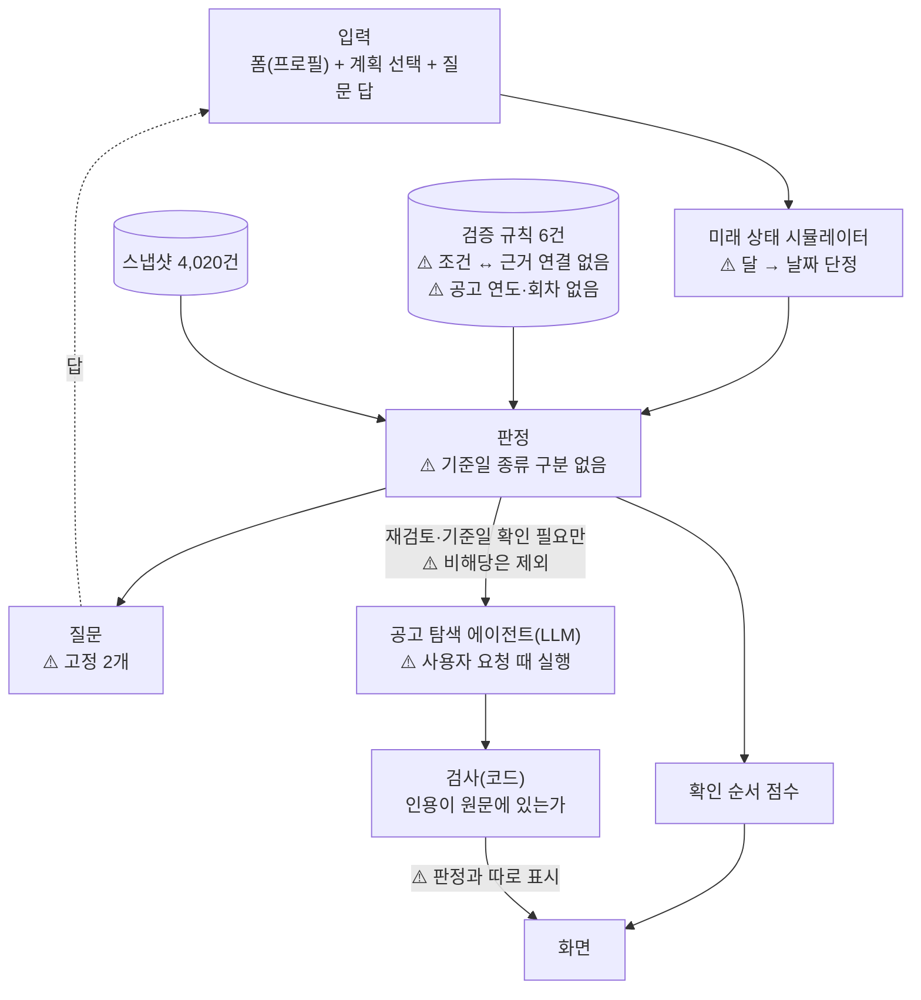
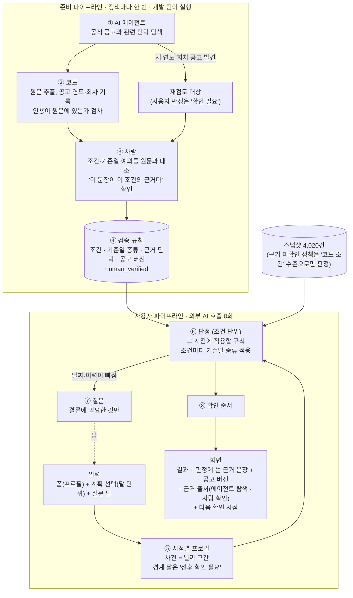
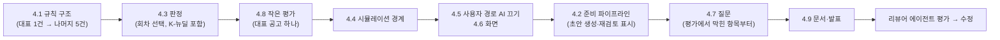

# PathFinder 구조 개선 계획

작성일 2026-11-18 · 3판(외부 AI 3차 검토 반영) · 대상 저장소 `KCCI-Hackathon/pathfinder` · 상태: 제안(구현 전)

## 1. 한 줄 요약

**사용자에게 보여주는 판정이 어떤 근거에서 나왔는지 끝까지 추적할 수 있게 한다.** 이를 위해 AI가 공식 공고를 찾는 시점을 "사용자가 요청할 때"에서 "규칙을 준비할 때"로 옮긴다.

| 단계 | 누가 | 다음 단계에 넘기는 것 |
|---|---|---|
| 공고 탐색 | AI 에이전트 | 공식 공고와 관련 단락 |
| 조건 확인 | 사람 | 그 단락에서 읽어낸 조건·기준일·예외 (승인된 규칙) |
| 판정 | 코드 | 승인된 규칙을 사용자 계획의 각 시점에 적용한 결과 + 쓴 근거 |

유지하는 것: 미래 상태 시뮬레이터, 코드 판정, 공고 탐색 에이전트 하나.

**이 구조가 보장하는 것과 보장하지 않는 것:**
- 보장: 판정에 쓴 규칙과 근거가 같은 공고 버전을 가리키고, 그 연결을 추적할 수 있다. 예전 판정 아래에 새 공고를 붙이는 문제는 없어진다.
- 보장하지 않음: 사람이 원문을 잘못 옮기면(예: "공고일"을 "신청일"로) 같은 원문을 보여줘도 계산은 틀린다. 이 위험은 4.8 평가와 두 사람 확인으로 줄인다.

---

## 2. 왜 고치나

### 2.1 논문과 실제 서비스를 교차 검증한 결과

| 원칙 | 논문 | 실제 서비스 | PathFinder 현재 |
|---|---|---|---|
| 판정·데이터는 코드, LLM은 판단·탐색 | ProADA, InteRecAgent | Spotify, Nava | ✅ 이미 이 구조 |
| 큰 데이터·상태는 프롬프트 밖에 | InteRecAgent(후보 버스), ProADA(사용자 정보 사전) | Spotify(세션 상태) | ✅ |
| 결과를 검사하는 단계 | InteRecAgent(비평가) | Shopify(채점기), Nava(인용 추출) | ⚠️ "인용이 원문에 있는가"만 검사 |
| 가상 사용자로 평가 | InteRecAgent, ProADA | Shopify | ⚠️ 경계 평가 없음 |
| 에이전트 수 | MACRec: 여러 개 | Shopify: 처음엔 하나 | **하나 유지** |
| 사용자 입력 해석 | ProADA: LLM | Spotify: LLM | **코드** (개인정보를 외부 AI로 보내지 않음) |

**미래 상태 시뮬레이터는 논문·실제 서비스 어디에도 없던 PathFinder 고유 단계다.** 제품 관점에서 가장 유망하고, 그래서 검증 우선순위도 가장 높다. 다만 비교 사례에 없다는 사실만으로 사용자가 더 나은 결정을 내린다고 말할 수는 없다.

### 2.2 가장 약한 연결: 판정한 규칙과 화면의 근거가 따로 논다

지금 흐름은 ③ 코드 판정 → ⑤ 순서 → ⑥ AI가 공고 탐색 → ⑦ 코드가 인용 검사다. **⑥에서 찾은 공고가 ③에서 쓴 규칙과 다르면 화면이 위아래로 반대 결론을 보여줄 수 있다.**

예: 저장된 규칙은 "신청일 기준 미취업", 올해 공고는 "공고일 기준 미취업"으로 바뀌었다. 사용자는 3월 1일 공고 당시 미취업, 3월 15일 취업, 3월 20일 신청 예정이다.

| 적용한 규칙 | 확인하는 날짜 | 미취업 조건 |
|---|---|---|
| 저장된 규칙 | 3월 20일 신청일: 이미 취업 | 미충족 |
| 올해 공고 | 3월 1일 공고일: 미취업 | 충족 |

AI가 올해 공고를 정확히 찾고 코드가 인용을 한 글자도 틀리지 않게 확인해도, 화면의 판정과 바로 아래 인용은 반대 결론을 가리킨다.

### 2.3 코드와 대조해 확인한 약점

1. **판정과 AI 검증 결과가 화면에서 따로 붙는다.** 판정은 사람이 확인한 규칙으로 하고, AI 검증은 그 아래 "공식 공고 기준 AI 확인(사람 검토 전)" 상자로 따로 나온다.
2. **비해당으로 나온 정책은 다시 확인하지 않는다.** 자동 검증 대상은 "자격 재검토"와 "기준일 확인 필요"로 바뀐 정책뿐이다. 규칙이 틀려서 비해당이 나온 경우를 잡지 못한다.
3. **규칙과 근거가 연결되어 있지 않다.**
   - 조건 목록과 인용 목록이 따로 있다. 어떤 인용이 어떤 조건의 근거인지 모른다.
   - 공고의 연도·회차를 저장하지 않는다(주소와 확인 날짜만).
   - **실제 오류:** K-뉴딜 아카데미. 기준일 설명에는 "개시일 전 해소되면 참여 가능"이 적혀 있는데, 판정 규칙은 "수강 중이면 제외"라 화면에 "조건상 비해당"이 나온다.
4. **기준일 종류를 구분하지 않는다.** 인천 응시료는 응시일 기준인데, 타임라인은 모든 정책을 "그 날짜에 신청한다면"으로 계산한다.
5. **시뮬레이션의 경계가 부정확하다.**
   - 사용자는 "수료 3개월 뒤"처럼 달만 고르는데, 내부에서는 2027-03-19처럼 날짜를 단정한다(가짜 정밀도).
   - 달마다 한 칸으로 보여줄 때 그 달 안에서 가장 열린 상태를 표시해, 3월 19일에 닫히는 정책도 3월 칸은 "열림"으로 보인다.
6. **검사의 목적이 하나뿐이다.** "그 문장이 원문에 있는가"(코드가 할 수 있음)만 검사하고, "그 문장이 이번 판정을 뒷받침하는가"(사람이 확인해야 함)는 기록하지 않는다.
7. **질문이 고정 2개다.**

### 2.4 이미 있는 것

준비 단계에서 AI가 공고를 찾는 길은 반쯤 있다.

- `scripts/verify-batch.ts`: Claude API로 여러 정책의 공고를 일괄 탐색
- `scripts/verify-replay.ts`: API 키 없이 같은 검증 루프를 재생 실행(시연 6건을 만든 방법)

다만 그 결과가 규칙 검토로 이어지지 않고 화면에 따로 붙었다.

### 2.5 지금 셀 수 있는 숫자

| 구분 | 지금 | 뜻 |
|---|---|---|
| 전체 정책 | 4,020건 | 온통청년 스냅샷(기준일 2026-11-16) |
| 사람이 확인한 규칙(현재 구조) | 6건 | 조건과 근거가 연결되지 않은 예전 구조 |
| 탐색 기록 재생 | 6건 | `verify-replay.ts`로 만든 시연용 탐색 결과. Claude API 실행이 아님 |
| **조건별 근거 검토를 마친 정책(새 기준)** | **0건** | 4.1 작업 뒤에 센다 |

발표에서는 이 세 숫자를 섞지 않는다. "공식 근거까지 확인한 정책 6건"이라고 말하지 않는다.

---

## 3. 구조도

### 3.1 지금



### 3.2 바꾼 뒤: 파이프라인 두 개



### 3.3 "확인 필요"의 두 종류와 다음 행동

| 원인 | 예 | 다음 행동 | 누가 푸나 |
|---|---|---|---|
| 사용자 정보가 빠짐 | 응시일, 취업 예정일, 최근 6개월 이력 | 사용자에게 질문 | 사용자 |
| 규칙이 불확실함 | 새 연도 공고 발견, 규칙과 공고가 다름 | 정책 재검토 | 팀 |

뒤의 경우는 사용자에게 질문을 더 해도 풀리지 않는다.

### 3.4 새 공고를 찾았지만 아직 검토 전일 때

규칙은 **정책 + 공고 회차** 단위로 저장한다. 사용자가 계획한 신청 시점이 어느 회차에 속하는지에 따라 쓸 규칙이 정해진다.

| 상황 | 사용자 화면 |
|---|---|
| 신청 시점이 작년 회차에 속하고, 그 회차 규칙이 승인됨 | 작년 규칙으로 판정, 작년 공고의 근거 표시 |
| 신청 시점이 올해 회차에 속하고, 새 공고는 찾았지만 검토 중 | **"올해 공고 기준 확인 중"**으로 표시하고 공식 공고로 연결. 예전 규칙으로 계산하지 않음 |
| 올해 규칙 검토가 끝났고, 판정에 필요한 사용자 정보만 빠짐 | 결과가 실제로 달라지는 항목만 질문한 뒤 올해 규칙으로 판정 |
| 신청 시점에 맞는 회차 공고가 아직 없음 | "다음 회차 공고 전"으로 표시. 지난 회차 규칙은 "참고"로만 보여줌 |

"재검토 대상" 표시가 팀 관리 화면에만 있고 사용자 화면이 예전 규칙으로 계산하면, 2.2의 문제가 다른 모양으로 남는다. 그래서 검토 중인 회차는 사용자 화면에서도 판정하지 않는다.

### 3.5 단계별 비교

| 단계 | 지금 | 바꾼 뒤 | 참고한 곳 |
|---|---|---|---|
| 공고 탐색(AI) | 사용자 요청 때 자동 실행 | **준비 단계에서 실행** | 외부 AI 2차 검토 |
| 인용 검사 | 인용이 원문에 있는가 | 같음(코드) + **판정을 뒷받침하는가(사람)** 따로 기록 | Nava, 외부 AI 2차 검토 |
| 규칙 | 조건과 인용이 따로 | 조건마다 기준일 종류 + 근거 + 공고 버전 | ProADA, 외부 AI 검토 |
| 시뮬레이터 | 달 → 날짜 단정 | 사건을 날짜 구간으로, 경계 달은 확인 필요 | 외부 AI 1차 검토 |
| 판정 | 정책 단위 | 조건 단위 | ProADA |
| 질문 | 고정 2개 | 막힌 조건에서 생성(평가 뒤) | ProADA |
| 화면 근거 | AI 검증 상자가 따로 | 판정 사유 옆에 그 판정에 쓴 근거 | Nava |
| 규칙 단위 | 정책 하나에 규칙 하나 | **정책 + 공고 회차** | 외부 AI 3차 검토 |
| 검토 중인 공고 | 개념 없음 | 사용자 화면에서 "확인 중"으로 판정하지 않음 | 외부 AI 3차 검토 |
| 탐색 대상 선정 | 판정 결과에 따라(재검토·기준일 확인 필요만) | **판정과 독립적으로** 선정 | 외부 AI 3차 검토 |
| 사용자 경로의 외부 AI 호출 | 정책 번호를 보냄 | **0회** | 개인정보 원칙 |

---

## 4. 바뀌는 것

### 4.1 규칙 데이터 구조 — 가장 먼저

**파일:** `data/verified/*.json` 6건, `lib/data/verified.ts`

| 지금 | 바꾼 뒤 |
|---|---|
| `statusConditions.requires / excludes` 목록 + 따로 있는 `quotes` 목록 | `conditions[]`: 조건마다 `key`, `kind`, `basis`, `quote`, `supportsConfirmed` |
| 기준일은 정책 전체에 문장 하나(`referenceDate.status`) | 조건마다 `basis`: `apply_date` / `exam_date` / `notice_date` / `fixed_date` / `resolvable_before_start` |
| `sources[]`: 주소 + 확인 날짜 | `notice`: 연도·회차·제목·주소·확인 날짜·**신청 기간** |
| 정책 하나에 규칙 하나 | 정책 하나에 **회차별 규칙 여러 개**. 회차마다 `status`: `approved` / `under_review` |
| 검증 출처 기록 없음 | `evidenceTrail`: 에이전트가 거친 단계(어떤 페이지를 열고 어떻게 판단했는지), 재생 실행이면 `replayed: true` |
| 확인자 하나 | `supportsConfirmed`에 확인자 기록. 가능하면 두 사람이 확인(원문을 잘못 옮기는 위험을 줄임) |

조건 하나의 예 (인천 청년 자격증 응시료 지원):

```json
{
  "key": "unemployed",
  "kind": "requires",
  "basis": "exam_date",
  "quote": {
    "text": "응시일 현재 미취업자 (2025.12.1. 이후 응시한 시험)",
    "source": "official",
    "url": "https://youth.incheon.go.kr/youthpolicy/youthPolicyInfoDetail.do?poly_seq=412"
  },
  "supportsConfirmed": { "by": "human", "at": "2026-11-16" }
}
```

```json
"notice": {
  "year": 2026,
  "round": null,
  "title": "2026 청년 자격증 응시료 지원",
  "url": "https://youth.incheon.go.kr/youthpolicy/youthPolicyInfoDetail.do?poly_seq=412",
  "checkedAt": "2026-11-16"
}
```

공고 연도·회차·제목은 위 예시처럼 형식을 보여주기 위한 값이다. 실제 값은 작업 때 공고를 다시 확인해 채운다.

### 4.2 준비 파이프라인

**파일:** `scripts/verify-batch.ts`, `scripts/verify-replay.ts`, 새 스크립트(규칙 초안 생성)

- **탐색 대상은 지금의 판정 결과와 독립적으로 고른다.** 지금은 "재검토"와 "기준일 확인 필요"로 바뀐 정책만 탐색해서, 규칙이 틀려 비해당으로 나온 정책은 다시 보지 않는다. 대신 대상 연령·지역·분야로 고른 목록을 정기적으로 탐색한다. 시연 6건만 반복해서는 다른 정책의 잘못된 비해당이 계속 남는다.
- 에이전트 탐색 결과에서 **조건별 근거 단락과 공고 버전**을 뽑아 규칙 초안(`draft`)을 만든다.
- 사람이 원문과 대조해 `supportsConfirmed`를 채우고 `human_verified`로 올린다. 그 전에는 판정에 쓰지 않는다(지금 코드도 draft는 걸러냄).
- 저장된 규칙과 다른 연도·회차의 공고를 찾으면 **그 회차를 `under_review`로 추가**한다. 사용자 화면의 처리는 3.4를 따른다.

### 4.3 판정

**파일:** `lib/judge/personal.ts`

- 신청 시점이 속한 **회차의 규칙**을 고른다. 그 회차가 `under_review`이거나 없으면 판정하지 않고 3.4의 문구를 쓴다.
- 조건마다 `basis`를 보고 판정한다.
  - `apply_date`: 그 시점의 상태로 판정
  - `exam_date`: 응시일을 모르면 "응시일 확인 필요"
  - `notice_date`, `fixed_date`: 그 날짜의 상태로 판정
  - `resolvable_before_start`: 해당 상태여도 "개시일 전 해소 여부 확인 필요"
- **K-뉴딜 수정:** "수강 중 제외"를 `resolvable_before_start`로 바꾼다. 수강 중이면 "개시일 전 수료 여부 확인 필요".
- 판정 사유에 **그 조건의 근거 인용과 공고 버전**을 붙인다. 화면에 보이는 근거는 판정에 실제로 쓴 것뿐이다.

### 4.4 시뮬레이션 경계

**파일:** `lib/route/timeline.ts`

- 사용자가 고른 "N개월 뒤"를 정확한 날짜가 아니라 **그 달 전체(구간)**로 다룬다.
- 그 달 이전은 사건 전, 그 달 다음부터는 사건 후로 계산한다.
- 사건이 있는 달은 **"선후 확인 필요"**로 두고, 무엇과 무엇의 선후인지 적는다(예: "신청일과 취업일").
- 달 칸에 "그 달 안에서 가장 열린 상태"를 쓰던 방식을 없앤다.

### 4.5 사용자 경로에서 외부 AI 호출 끄기

**파일:** `app/page.tsx`, `app/api/verify/route.ts`

- 상태를 바꿨을 때 `/api/verify`를 자동으로 부르던 것을 끈다.
- `/api/verify`는 준비 단계와 시연용(가상 인물)으로만 남긴다.

### 4.6 화면

**파일:** `app/page.tsx`, `app/page.module.css`

- 정책을 펼치면 판정 사유마다 **근거 문장, 공고 연도, 확인 날짜, 원문 링크**를 보여준다.
- 그 아래 **근거 출처**: "에이전트가 2026-11-16에 공식 공고에서 찾고, 사람이 확인했습니다" + 에이전트가 거친 단계(펼치기). 재생 실행으로 만든 기록이면 **"탐색 기록 재생"**이라고 표시한다.
- 검토 중인 회차는 "올해 공고 기준 확인 중" + 공식 공고 링크.
- 따로 붙던 "AI 확인(사람 검토 전)" 상자는 없앤다.
- 시뮬레이션에 "선후 확인 필요" 칸과 범례를 추가한다.
- "확인 필요"마다 다음 행동을 구분해 적는다: 사용자가 답할 것 / 팀이 재검토 중인 것.

### 4.7 질문

**파일:** `lib/agent/questions.ts`

- 판정이 "확인 필요"로 막힌 조건 중 **사용자 정보가 빠진 경우**에서만 질문을 뽑는다. 규칙이 불확실한 경우는 묻지 않는다.
- 다른 조건에서 이미 탈락한 정책 때문에는 묻지 않는다.
- 4.8 평가를 먼저 돌려, 실제로 막히는 항목부터 질문을 둔다.

### 4.8 평가 — 작은 평가를 먼저

**대표 공고 하나**(인천 청년 자격증 응시료 또는 K-뉴딜 아카데미)로 세 가지를 확인한다.

| 확인 | 기대 결과 |
|---|---|
| ① 기준일 직전·직후에 취업한 사람 | 결과가 경계에서 정확히 바뀐다 |
| ② 날짜가 불명확한 사람 | 결론에 필요한 질문이 나오거나, 그 달이 "선후 확인 필요"로 나온다 |
| ③ 결과에 붙은 원문만 읽은 사람 | 그 원문으로 판정을 설명할 수 있다 |
| ④ 예전 회차 규칙으로는 비해당, 새 회차 공고로는 충족하는 경우 | 새 회차가 검토 중이면 "확인 중", 승인 뒤에는 충족으로 바뀐다. 예전 규칙으로 비해당을 고정하지 않는다 |

④는 실제 공고가 없으면 가상 회차 데이터로 테스트한다.

그다음 전체 테스트:

| 테스트 | 확인하는 것 |
|---|---|
| 경계 앞뒤 | 같은 사람에서 날짜 하나만 바꿨을 때 결과가 정확히 뒤집히는가 |
| 기준일 종류 | 응시일 기준 정책이 신청일 기준으로 계산되지 않는가 |
| 조건 ↔ 근거 연결 | 모든 조건에 근거 인용과 `supportsConfirmed`가 있고, 인용 주소가 그 정책의 공고 주소와 맞는가 |
| 판정과 근거의 일치 | 화면에 붙은 근거가 판정에 실제로 쓴 조건의 것인가 |
| 회차 선택 | 신청 시점에 맞는 회차 규칙을 쓰는가, 검토 중인 회차는 판정하지 않는가 |
| 사용자 경로 | 판정 요청 처리 중 외부 호출이 0회인가 |
| K-뉴딜 | 수강 중이면 "비해당"이 아니라 "개시일 전 수료 여부 확인 필요"인가 |

### 4.9 문서와 발표 문구

- 설계 문서와 README에 두 파이프라인과 새 규칙 구조를 적는다. Obsidian `10_Projects/대한상공회의소`에도 복사한다.
- **범위를 나눠 말한다:** "전체 정책 4,020건 / 탐색 시연 6건 / 조건별 근거 검토를 마친 정책 N건." N은 4.1 작업 뒤에 센다(2.5).
- **보장 범위를 정확히 말한다:** "판정과 근거가 엇갈릴 수 없다"가 아니라 "판정에 쓴 규칙과 근거를 추적할 수 있다."
- **시연에서 보여줄 두 가지 (대표 정책 한 건으로):**
  1. **사용자에게 왜 필요한가:** 같은 사람의 취업 예정일만 기준일 직전과 직후로 바꾼다. 결과가 바뀌고, 그 옆의 공고 문장에 실제로 그 기준일이 적혀 있다.
  2. **AI가 무엇을 해냈는가:** 같은 결과에서 근거 출처를 펼쳐, AI가 어떤 공식 공고와 단락을 찾았고 사람이 무엇을 승인했는지 보여준다. 재생 기록이면 "탐색 기록 재생"이라고 표시한다.
- **설명 문구 목표:** "결과가 달라졌어요"에서 한 걸음 더, **"이 공고는 신청일의 취업 상태를 보기 때문에, 신청 예정일을 바꾸면 이 조건의 결과가 달라져요."**

---

## 5. 진행 순서

**먼저 완성할 단위:** 대표 정책 한 건에서 "공식 공고 → 조건별 승인 → 시점별 판정 → 화면의 근거"가 연결되고, 새 회차 공고가 검토 중일 때도 올바르게 처리되는 흐름. 그 한 건이 끝나면 나머지 5건을 같은 기준으로 옮기며 "검토 완료 N건"을 센다.



- 각 단계는 실패하는 테스트를 먼저 쓰고 고친다.
- 4.1이 가장 품이 든다(규칙 파일 6건을 모두 다시 씀).
- 4.2의 자동 초안 생성은 API 키가 있어야 실제로 돌릴 수 있다. 키가 없으면 `verify-replay.ts` 방식으로 시연용 1건만 만든다.

---

## 6. 하지 않는 것

| 항목 | 이유 |
|---|---|
| 사용자 요청 때 AI가 공고를 찾는 것 | 판정과 근거가 엇갈릴 수 있음(2.2). 준비 단계로 옮김 |
| 다중 에이전트로 나누기 | 맡길 일이 "공식 공고와 관련 단락 찾기"로 분명하고, 역할을 나눠서 줄일 오류가 아직 특정되지 않음 |
| 사용자 자연어 입력을 LLM이 해석 | 개인정보를 외부 AI로 보내지 않는다는 원칙과 충돌 |
| 논문 수치를 PathFinder 성능으로 말하기 | ProADA의 81.3%는 코드 판정을 택한 근거일 뿐, PathFinder의 정확도는 자체 평가로 확인해야 함 |

### 정해야 할 것

- 앱 이름: 화면·README·설계 문서는 아직 "갈림길". PathFinder로 바꿀지 정하면 4.6 작업 때 함께 바꾼다.
- 대표 공고(4.8): 인천 청년 자격증 응시료(응시일 기준) 또는 K-뉴딜 아카데미(신청일 기준 + 개시 전 해소).

---

## 7. 참고 자료

### 논문

- [ProADA / BeNYfits: Program Synthesis Dialog Agents for Interactive Decision-Making](https://arxiv.org/html/2502.19610v3) — 판정은 코드, 빠진 정보만 질문. 사용자 연구 정확도 81.3% vs LLM 직접 판정 42.1%
- [InteRecAgent: Recommender AI Agent](https://arxiv.org/html/2308.16505) — 후보 버스, 계획 먼저(호출 4.51 → 2.78회), 비평 단계
- [RecMind](https://arxiv.org/html/2308.14296v3) — 버린 탐색 경로 기록
- [MACRec](https://arxiv.org/html/2402.15235v3) — 역할별 다중 에이전트(정량 실험 없음)
- [A Survey on LLM-powered Agents for Recommender Systems](https://arxiv.org/pdf/2502.10050) — 프로필·메모리·계획·행동

### 실제 서비스

- [Spotify: Our Multi-Agent Architecture for Smarter Advertising](https://engineering.atspotify.com/2026/2/our-multi-agent-architecture-for-smarter-advertising) — 라우터 → 해석 에이전트 → 규칙 엔진
- [Nava: Building a trustworthy AI chatbot](https://www.navapbc.com/case-studies/building-a-trustworthy-ai-chatbot) — LLM은 단락 지목, 인용은 코드가 추출, 지정 문서만 근거
- [Shopify: Building production-ready agentic systems](https://shopify.engineering/building-production-ready-agentic-systems) — 초기엔 단일 에이전트, 가상 사용자 평가
- [Booking.com agent strategy (VentureBeat)](https://venturebeat.com/ai/booking-coms-agent-strategy-disciplined-modular-and-already-delivering-2) — 작은 모델/큰 모델 분리
- [Amazon Rufus](https://amazon.science/blog/the-technology-behind-amazons-genai-powered-shopping-assistant-rufus) — 신뢰 출처 검색, 실시간 데이터는 나중에 채움

### 팀 내부

- 설계 문서: `docs/2026-11-16-policy-twin-design.md`
- 외부 AI 1차 검토(2026-11-18): 시뮬레이터 유지, 규칙↔근거 연결 우선, 경계 평가 우선
- 외부 AI 2차 검토(2026-11-18): AI가 근거를 찾는 시점을 규칙 준비 단계로, 검사 목적 두 가지 구분, 작은 평가 먼저, 4,020건 범위 구분
- 외부 AI 3차 검토(2026-11-18): 두 파이프라인 채택. 보장 범위를 "추적 가능"으로 정확히, 탐색 대상을 판정과 독립적으로, 숫자 세 가지 구분, 검토 중 회차의 사용자 화면 처리, 대표 정책 한 건 전 과정 먼저
