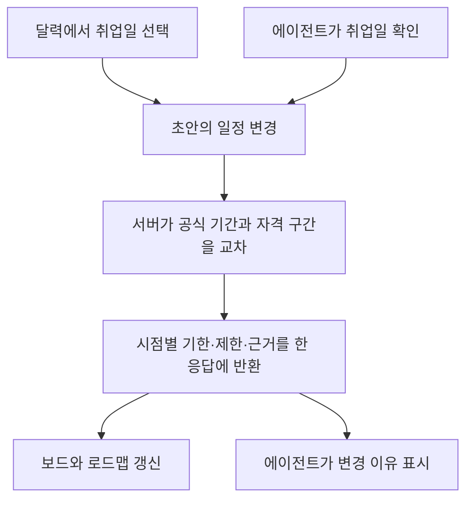

# Pathfinder · 갈림길 | 기능·화면·개발 명세서
**해커톤 구현 기준 v1.0 · 2026년 11월 21일 · 에이전트 담당 1명 / 백엔드 담당 1명**

## 1. 처음 구현할 사용자 흐름

사용자가 알고 싶은 것은 **“내가 취업하거나 이사하면 어떤 정책을 언제까지 신청할 수 있을까?”**이다. 첫 화면은 사용자의 현재 계획을 연다. 사용자는 생활 변화 전후의 정책을 비교하고 카드에서 직접 담는다. 날짜를 고치면 내 기한과 선택 제한이 함께 바뀐다. 계획을 저장하면 로드맵에서 같은 날짜와 정책으로 다시 볼 수 있다.

| 순서 | 시연할 행동 | 화면에서 확인할 결과 |
|---|---|---|
| 1 | 예시 프로필로 정책 선택하기 열기 | 내 일정 → 내 계획 → 분야·보기 필터 → 시점별 정책 보드. 현재, 수료 후, 취업 후 열이 시간순으로 보인다. |
| 2 | 수료 후 열에서 ‘수료생 구직 지원’ 확인 | 기준일 2026.11.19, 수료 12.19, 취업 2027.01.20이면 우측 상단 **D−61**, 본문 **내 예상 기한 1월 19일**, 다음 줄 **공고 마감 2월 26일**. 상세에는 실제 접수 시작 1월 5일. |
| 3 | ‘담기’ 후 취업 칩을 눌러 2월 13일 선택 | 시점 칩과 달력 위치가 이동한다. 이미 담은 정책은 남고 기한이 **2월 12일 · D−85**로 갱신된다. 공고 마감은 2월 26일 그대로다. |
| 4 | 취업을 1월 3일로 변경 | 취업 전날까지의 자격과 1월 5일부터의 접수가 겹치지 않는다. ‘내 계획’에서 해당 항목에 **현재 일정으로 신청 불가**와 두 날짜가 보인다. ‘되돌리기’ 한 번이면 2월 13일로 복원된다. |
| 5 | 다른 정책을 직접 담고 추천 경로 미리보기 | 내 선택과 추천이 각각 보인다. 추천을 ‘새 계획으로 저장’하면 직접 만든 초안을 계속 편집할 수 있다. |
| 6 | 내 정책 로드맵에서 저장한 계획 두 개를 전환 | 계획별 시점·선택 정책·날짜축·막대가 동시에 바뀐다. |

위의 정책명·금액·규칙·일정은 화면 검증용 가상 데이터다. 실데이터에는 해당 모집 회차에서 확인한 규칙과 출처를 연결한다.

### 구현 기준을 읽는 법

- **제품 결정**은 노션의 「정책 선택하기 페이지」, 최신 요청, 배포 시안에서 확인한 요구다. 카드 디자인과 달력 방식은 최신 시안을 우선한다.
- **구현 기본값**은 팀원이 개발을 시작할 수 있게 정한 세부사항이다. 추천 상단 요약과 본문 정렬의 조합, 저장 형식 v2, 모바일 상세창, 동일 날짜 충돌 처리, 아래의 추가 응답 형식이 여기에 속한다.
- 첫 버전의 저장 기준은 **이 브라우저에 여러 계획 저장**이다. 계정 버튼·프로필 편집·데모 진입은 구현한다. 실제 로그인 및 기기 간 동기화가 필요할 때 바뀌는 범위는 9장에 명시했다.
- 개발 순서는 12장, 날짜와 선택 여부를 결정하는 규칙은 5~6장, API 구현은 8장, 완료 판정은 13장에서 찾을 수 있다.

## 2. 현재 코드에서 출발할 위치

| 구분 | 확인한 동작·코드 | 구현할 변경 |
|---|---|---|
| 디자인 기준 | Sites의 정적 HTML/CSS/JS에 밝은 작업 보드, 탐험가 로봇, 시점 카드·달력, 카드 상세, 추천, 저장, 로드맵이 있다. 12개 예시 정책, 고정 기준일을 사용한다. | 화면과 클릭 흐름을 React로 옮기고, 데이터는 서버 판정 결과를 연결한다. |
| 앱 진입 | 팀 저장소는 Next.js App Router + React + TypeScript. `app/page.tsx`가 프로필·상담·판정 요청을 조립한다. | 기존 언어 유지. 화면 공통 상태와 서버 결과를 관리하고 동일한 정책 카드 컴포넌트를 보드와 확대 보기에서 재사용한다. |
| 보드·로드맵 | `app/planner/PipelineBoard.tsx`, `Roadmap.tsx`, `Panels.tsx`, `shared.ts`, `planner.module.css`가 있다. 월별 마감 열과 월 단위 좌표가 쓰인다. | 보드 열의 키를 생활 시점으로, 로드맵 좌표를 일 단위로 전환한다. 기존 월별 결과를 읽는 호출자는 유지한다. |
| 판정 | `app/api/judge/route.ts` → `lib/judge/handler.ts`. 기존 응답은 `items, questions, timeline, roadmap, pipeline, today, asOf` 등을 반환한다. | 모집·개인·시기·제한 판정과 근거를 재사용한다. 회차별 신청 가능 구간과 UI용 상태를 같은 서버 계산에서 도출한다. |
| 일정 | `lib/judge/types.ts`는 날짜와 scheduled/completed/simulated 이벤트를 표현한다. `lib/route/timeline.ts`의 계획 입력에는 취업·창업·이사를 ‘몇 개월 후’로 표현하는 값이 있다. | 달력에서 선택한 정확한 날짜를 보존한다. 이전 개월 입력만 있으면 기존 계산을 한 번 거쳐 날짜로 정규화한다. 양쪽 값이 있으면 명시한 날짜를 우선한다. |
| AI | `/api/plan`, `/api/agent`, `/api/verify`가 있고 `lib/ai/client.ts`가 공급자를 선택한다. `AI_PROVIDER=gemini`일 때 Gemini 어댑터를 쓴다. | 기존 서버 어댑터와 후보 검증을 재사용한다. 날짜·중복 여부·담기 허용은 규칙 엔진이 결정한다. |
| 저장 | 팀 앱 `galimgil.mine.v1`은 정책 ID 목록, 시안 `pathfinder-selection-plans-v1`은 이름·이벤트·선택·조건 스냅샷이다. | 정책 ID 목록만으로 과거 시점을 추정하지 않는다. 저장 계획 식별자·스키마 버전·판정 시각을 추가한다. |

조사 기준은 Sites 소스 `6055a332`, 팀 저장소 로컬에서 확인한 `frontend/ui-development`와 원격 추적 참조 `origin/frontend/ui-development`의 `c19a6b34`다. 별도 브랜치에 있는 변경은 통합 시 대조한다. 아래의 새 타입·경로·필드 이름은 구현 제안이다.

## 3. 화면 구조와 디자인

### 3.1 화면별 배치

| 화면 | 위에서 아래로 배치 | 진입·이탈 |
|---|---|---|
| 시작 / 계정 | Pathfinder 로고, ‘예시로 둘러보기’, ‘내 정보로 시작’, 현재 저장 방식 안내. 데모 사용자는 예시 표식. | 내 정보로 시작하면 입력 → 시점별 보드. 이미 편집 중이면 메뉴를 오가도 같은 초안. 실로그인 도입 시 계정 진입을 로그인 제공자에 연결. |
| 공통 메뉴 | 데스크톱 좌측 흰 내비게이션에 로고, 정책 선택, 내 정책 로드맵, 하단 계정. 현재 탭에 옅은 파란 배경과 텍스트. 에이전트는 보조 패널. | 탭 전환은 초안·필터를 보존. 계정에서 내 정보 편집과 저장 위치를 확인. |
| 정책 선택 | 화면 제목·내 정보 키워드 → **내 일정** → **내 계획** → 분야 / 추천 / 신청 불가 모아보기 → **시점별 보드**. 에이전트는 우측. | 첫 진입은 전체 분야, 추천 꺼짐, 신청 불가 모아보기 꺼짐. 빈 계획이어도 보드 전체를 탐색할 수 있다. |
| 시점 전체 보기 | 어두운 배경 위 중앙 모달. 시점명·기간·정책 수·닫기 → 카드 격자. 제목 옆 ‘정책 N개 전체 보기’ 접근 가능한 이름. | 보드의 **열 제목**을 클릭. 일정의 **날짜 칩**을 누르는 동작과 구별. 배경·닫기·Esc로 원위치 복귀. |
| 내 정책 로드맵 | 계획 선택 드롭다운 → 선택한 계획의 **내 일정** → **내 계획** 요약 → 기간 범례와 행 목록. 좌측 정책 카드, 우측 날짜 막대. | 편집 중 계획, 내가 저장한 계획, 예시 계획을 구분. 저장본은 ‘복사해 편집’으로 새 초안을 연다. |
| 에이전트 | 로봇 얼굴, 대화 이력, 예시 질문, 입력창·전송. 좁은 화면에서는 에이전트 열기 버튼과 서랍. | 보드·로드맵에서 접근. 저장본을 보고 일정 수정 명령을 하면 어느 계획을 수정할지 표시하고 복사 편집으로 안내. |

### 3.2 색·크기·간격

참조 이미지의 밝은 보드, 둥근 흰 카드, 좁은 탐색 영역과 일정한 카드 간격을 따른다. 브랜드 캐릭터는 메뉴 로고·상담 아바타에 사용하고 카드 면적은 정책명과 날짜에 쓴다.

| 역할 | 기준값 | 적용 위치 |
|---|---|---|
| 주요색 | 네이비 `#192655`, 블루 `#3876BF` | 본문 제목·활성 메뉴·주요 버튼·선택 테두리·개인 신청 기간 |
| 포인트 | 샌드 `#E1AA74`, 크림 `#F3F0CA` | 마감 지점·임박 D-day 배경·주의 영역. 작은 글자는 네이비. |
| 바탕 | 바깥 `#E7EDF7`, 작업면 `#F0F1F3`, 열 `#F7F7F8`, 카드 `#FFFFFF` | 단계별로 면을 구분. 비활성 카드 본문·이유는 읽을 수 있는 대비 유지. |
| 글자 | 본문 네이비, 보조 `#4E5972`. 한글 시스템 산세리프 + sans-serif, 날짜 숫자는 등폭 숫자 | 화면 제목 26~30px, 열 제목 18~20px, 정책명 18px/1.4 굵게, 본문 16px/1.5, 보조·배지 14px. 200% 확대 시 세로 확장. |
| 카드·열 | 카드 반경 13px, 열 반경 16px, 카드 안쪽 13~16px, 카드 간격 10px, 열 간격 14px | 고정 카드 높이 금지. 긴 제목은 기본 2줄, 상세에 전문. 금액·공고일·액션이 서로 겹치지 않게 배치. |
| 분야 | 팀 코드의 job·startup·housing·edu·life 매핑 사용 | 취업·일자리 / 창업 / 주거 / 교육·학습 / 생활·복지. 짧은 분야 글자와 작은 컬러 표시를 함께 사용. 시안의 4개 분야에 팀 데이터의 창업을 포함. |
| 상태 | 선택은 파란 외곽선 + ‘✓ 담음’, 추천은 ‘추천’ 라벨, 제한은 회색 면 + 사유, 확인 필요는 크림색 + 문구 | 세 상태가 동시에 있어도 판정 사유와 기한이 읽혀야 한다. 빨간색·회색만으로 의미를 전달하지 않는다. |

**반응형**. 1100px 초과에서 좌측 내비 약 118px, 우측 에이전트 206~248px, 보드가 나머지를 쓴다. 761~1100px는 상단 내비로 전환하고 보드가 가로로 스크롤된다. 760px 이하에서는 에이전트를 기본 닫고 최대 320px 또는 화면의 91% 서랍으로 연다. 한 열의 폭은 약 73vw, 최소 232px. 다른 열 일부가 보여 옆으로 넘길 수 있음을 알린다. 추천 격자·시점 모달은 폭에 따라 3→2→1열. 360px에서 카드 안의 정보는 가로 스크롤 없이 읽혀야 한다. 날짜축·보드의 가로 스크롤은 페이지 전체와 분리한다.

### 3.3 정책 카드 해부

| 위치 | 기본 표시 | 분기와 동작 |
|---|---|---|
| 상단 좌측 / 우측 | 분야 / **D−N** | 0일은 ‘D-day’, 1~10일은 임박 강조. 이미 마감이면 ‘마감’, 계산 근거가 없으면 ‘기한 확인’. 우측 자리는 카드마다 동일. |
| 중앙 첫 줄 | 정책명 | hover 또는 키보드 focus로 한 줄 요약·핵심 자격·접수 개시 미리보기. 클릭·Enter·모바일 탭은 상세. |
| 중앙 두 번째 줄 | **내 예상 기한 M월 D일** 또는 **신청 기한 M월 D일** | 생활 변화로 공식 마감보다 빨라지면 아래 ‘취업 예정일 기준 · 공고 마감 M월 D일’. 공고가 먼저 닫히면 공식 마감이 대표 날짜다. 다음 연도 날짜는 연도도 표시. |
| 설명·경고 | 지원 내용 한 줄 | 개시 전이면 ‘M월 D일부터 접수’. 제한·확인 사유는 즉시 읽을 수 있게 노출. 공간이 좁으면 상세에 금액·기관·전문 배치. |
| 하단 | 다른 시점 관계 / 담기 | 미선택 ‘담기’, 같은 시점 ‘✓ 담음’(빼기), 다른 시점 선택됨 ‘이 시점에 담기’, 초안과 확정 충돌 ‘비교·교체’, 실제 수혜와 충돌 ‘제한 사유’. |
| 상세 | 정책명·회차, 지원 내용, 해당 시점, 공식 접수 시작·마감, 내 시작·마감과 계산 이유, 제한 상대, 확인할 항목, 공식 근거, 담기 동작 | 공식 링크·문서 기준일·검토 상태 제공. 기관 확인이 필요한 조건은 확인 질문을 제시. 상세와 목록의 담기 결과는 즉시 동기화. |

카드 본문 전체를 한 개의 중첩 버튼으로 만들지 않는다. 제목과 ‘담기’를 별도 버튼으로 두어 상세 조회가 선택으로 이어지지 않게 한다. 날짜·제한·담기는 툴팁을 열지 않아도 이용 가능해야 한다.

## 4. 사용자 조작 명세

| ID | 시작과 입력 | 화면 결과 / 예외 처리 |
|---|---|---|
| F01 내 정보 | 예시로 시작하거나 출생연월·거주 시군구·학력 입력. 이어 현재 상태, 참여 정책, 예정일 등 판정에 필요한 질문에 답한다. | 기존 Profile 형식으로 정규화한다. ‘모름’과 ‘해당 없음’을 나눈다. 예시값을 실사용자 답으로 채우지 않는다. 질문을 건너뛰면 그 값에 의존하는 카드에 ‘확인 필요’. |
| F02 키워드 | ‘인천 거주’, ‘수혜 중’, ‘취업 예정’ 칩 클릭 → 이 계획에서 잠시 끄기 / 다시 켜기 / 수정하기. | 꺼진 칩은 ‘꺼짐’. 지역·수혜 사실을 끈 경우 해당 조건의 확정 판정과 추천을 보류한다. 관심 분야를 끄면 추천 가중치만 빠진다. 미래 예정일은 계획 일정 편집으로 이동. 프로필 변경은 현재 초안에 적용하고 저장본은 유지. |
| F03 내 일정 | 월·일 눈금을 가진 긴 가로 기간 위에 실제 날짜 위치에 시점 칩을 놓는다. 칩 클릭 → 달력 → 날짜 한 번 클릭. | 선택 즉시 적용, 칩이 보이는 위치로 이동, 해당 보드 열에 초점 표시. 칩 아래 연결선 없음. 칩이 겹치면 위아래 두 줄로 배치. ‘오늘’은 오늘이 속한 열과 날짜로 이동하며 예정일은 그대로다. |
| F04 에이전트 일정 편집 | “2월 13일에 취업 예정이야”, “3월 1일 서울로 이사해”. 사건·날짜·필수 지역이 명확하면 즉시 한 번 적용. | 변경 전·후 날짜, 영향받은 정책 수, ‘되돌리기’ 제공. 연도나 지역이 모호할 때는 한 가지 보충 질문 후 반영. 동일 입력 재전송 시 이벤트 중복 방지. |
| F05 되돌리기 | 날짜 변경·시점 추가·제거를 한 동작씩 해당 초안 이력에 기록. 달력 한 번 선택 = 한 건. | 마지막 변경부터 복구. 추가를 취소하면 해당 사건 제거. 다른 정책 선택·프로필 값은 보존. 새 편집본 진입 시 이력 초기화. 빈 이력 버튼은 비활성. |
| F06 기본 보드 | 열은 날짜순, 정책은 열마다 내 기한 오름차순. 같은 정책이 이어지는 열에도 카드를 표시. | 열 머리에 시점명·기간·총 개수. 처음 4개, 열 하단 도달 시 4개씩 추가. ‘더 보기’도 제공. 전체 개수와 현재 노출 개수 구분. 필터 후 0개인 열도 시점명과 빈 상태 유지. |
| F07 보기 필터 | ‘전체’ 또는 분야 한 가지, ‘신청 불가 모아보기’ 토글, ‘AI 추천 경로 보기’. | 분야 선택은 표시만 변경. 기본 목록에는 그 시점의 후보를 표시하며 담은 정책·수혜 정책과 확정 충돌한 후보도 사유와 함께 남긴다. 불가 보기에는 기간·자격이 어긋나 원래 숨겨진 항목까지 모은다. 불확실은 불가 목록에 넣지 않는다. |
| F08 열 확대·상세 | 열 제목 → 어두운 배경과 그 시점의 카드 격자. 카드 제목 → 상세. | 보드와 동일 필터·정렬·선택 상태. 모달에서는 해당 열 전부를 탐색할 수 있다. Esc는 최상위 상세부터 한 단계 닫고, 배경 여백 클릭은 해당 창만 닫는다. 닫으면 원래 열·스크롤·포커스 유지. |
| F09 직접 담기 | ‘담기’ → 초안에 즉시 추가. 같은 회차를 다른 열에서 ‘이 시점에 담기’ → 기존 위치와 새 위치 확인 후 이동. | 내 계획의 수량·칩·충돌 사유가 한 번에 갱신. ‘✓ 담음’ 또는 계획 칩 ×는 해당 항목만 제거. 에이전트에 “담아줘”라고 입력하면 해당 카드 위치와 담기 버튼을 안내한다. |
| F10 중복 정책 교체 | 초안 정책과 충돌한 카드의 ‘비교·교체’ → 기존/후보의 지원 내용, 예상 기한, 공식 마감, 제한 근거 표시. | ‘A 대신 B 담기’에서만 교체. 여러 정책이 걸리면 제거될 모든 항목을 열거하고 한 번에 적용. 수혜 중 정책과의 충돌은 교체 대상이 될 수 없다. 취소하면 이전 초안 유지. |
| F11 추천 | 추천 보기를 켜면 전체 분야·기본 후보 보기로 전환, 추천 후보를 현재 조건으로 생성. | 보드 상단의 접근 가능한 추천 요약에 시점별 카드 바로가기와 ‘새 계획으로 저장’을 표시한다. 추천 카드 원본은 각 열의 D-day순에 그대로 두고 배지·테두리로 강조한다. 미추천 카드도 상세와 담기를 지원. 요약의 바로가기는 미로딩 카드까지 펼쳐 이동한다. |
| F12 저장 | ‘계획 저장’ 또는 추천 ‘새 계획으로 저장’ → 이름과 정책·시점 목록 검토. | 이름 앞뒤 공백 제거, 1~35자, 선택 0개는 저장 불가. 추천은 초안 대비 추가·빠짐·시점 이동을 표시. 저장할 때마다 새 ID를 발급하고 원본 유지. 확인 필요·일정 불가가 있으면 경고 개수와 사유를 보여준 뒤 명시적으로 보관 가능. |
| F13 로드맵 | 드롭다운에서 편집 중 / 저장본 / 예시 선택. 저장본 ‘복사해 편집’. | 선택한 계획의 데이터만 읽는다. 다른 초안에 미저장 변경이 있으면 ‘현재 초안 계속’ 또는 ‘복사본 열기’ 확인. 계획 재조회 시 원본 선택과 경고를 유지. |
| F14 프로필·메뉴·복귀 | 계정 버튼 → 계정 상태·저장 장소·프로필. 에이전트 열기·닫기, 메뉴 이동, 모바일 뒤로. | 오버레이 닫기 → 열 확대 닫기 → 이전 화면 순서. 저장 성공 메시지는 실제 저장 성공 뒤에만. 샘플 계정에는 ‘예시 프로필’ 표시. |

추천 표시는 **무한 스크롤 목록 맨 위로 정책 원본을 재정렬하는 대신, 위쪽에 요약을 고정하는 설계안**이다. 요약 제목을 눌러 접을 수 있고, 모바일에서는 한 줄 요약에서 ‘경로 보기’로 펼친다. 긴 목록 중간에서 추천을 켜도 상단 요약을 보이게 하고 원래 첫 노출 카드 ID를 기억한다. 추천을 끄면 이전 분야·불가 보기·스크롤을 복원한다. 필터를 직접 바꾸면 추천 요약 내에 ‘현재 필터에서 숨김’ 상태를 표시하고, 바로가기에서 해당 필터를 해제할지 선택할 수 있다.

## 5. 날짜·시점·D-day 계산 명세

### 5.1 용어와 저장 단위

| 값 | 누가 결정하는가 | 해석 |
|---|---|---|
| 기준일 `today` | 운영은 서버의 서울 날짜, 시연은 고정 시계 | 모든 열의 D-day 분모가 같은 오늘이다. 열 시작일까지 남은 일수와 구분한다. |
| 데이터 기준일 `asOf` | 정책 데이터 공급 시점 | 화면에 ‘공고 데이터 기준’으로 표시한다. 오늘이나 모집 마감으로 쓰지 않는다. |
| 공식 접수 기간 | 모집 회차의 공고 | 시작·종료 날짜 포함. 마감 시각이 공시되면 시각·시간대를 함께 보존. |
| 내 상태 구간 | 현재 사실 + 해당 계획의 예정 사건 | 사건 당일 0시부터 새 상태를 가정한다. 예를 들어 1월 20일 취업 전 마지막 날은 1월 19일. 예정은 ‘예정’으로 표시. |
| 내 신청 가능 구간 | 공식 접수와 조건을 모두 만족하는 시간의 교집합 | 실제 신청일 기준 조건만 이렇게 자른다. 공고일·심사일·입주일 기준 조건은 회차 규칙의 기준 날짜에서 판정. |
| 표시 범위 | 화면 축의 첫날과 마지막 날 | 스크롤·그리기 전용. 축이 3월에 끝나도 4월 공식 마감을 3월 마감으로 계산하지 않는다. |

### 5.2 계산 절차

1. 서버에서 공고 회차, 검토된 규칙, 기준 시각, 프로필, 활성 조건, 현재 초안 사건을 읽는다. 날짜는 `YYYY-MM-DD`로 유효성 검사한다. 월말·윤년을 검증하고 브라우저 현지 시차로 날짜가 하루 움직이지 않게 한다.
2. 이미 일어난 사건은 현재 사실에 반영하고, 예정 사건은 해당 계획의 미래 상태에만 반영한다. 날짜순으로 정렬하고 같은 날짜의 사건을 하나의 경계로 묶는다. 수료+취업이 같은 날이면 직전 날까지 이전 열, 당일부터 두 변화가 모두 적용된 열이다. 같은 날 서로 다른 두 이사 목적지처럼 모순되는 입력은 어느 사건을 수정할지 묻는다.
3. 내부 계산은 `[시작일, 다음 시작일)`로 한다. 화면에는 마지막 포함일을 쓴다. 마지막 상태는 차후 경계가 없으면 열린 구간이다. 시점 ID는 날짜가 아닌 사건 ID에 기반한다. 날짜만 옮길 때 담은 정책이 새 카드로 복제되지 않는다. 동시 사건을 묶는 열의 키는 정렬된 사건 ID 조합으로 만든다.
4. 각 회차에 대해 상태 구간과 공식 접수 기간을 교차한다. `시작 = max(접수 시작, 자격 시작)`, `종료 = min(접수 종료, 자격 종료)`. 양끝이 같은 하루도 유효하다. 자격 조건의 기준일이 여러 개면 각각 판정하고 불명확한 조건은 확인 필요로 남긴다.
5. 인접한 두 열 사이에서 같은 회차의 자격이 하루도 끊기지 않으면 두 조각을 하나의 신청 가능 기간으로 연결한다. **카드가 보이는 열은 두 개여도 대표 기한은 연속 구간의 실제 끝**이다. 중간에 하루라도 자격이 끊기면 앞 열의 기한은 첫 구간의 끝, 뒤 열은 새 구간의 끝이다. 카드 상세는 ‘이 열에서 신청 가능한 첫날’과 ‘이어지는 기한’을 표시한다.
6. `남은 날 = 대표 기한의 서울 달력 일자 − 오늘의 서울 달력 일자`. 마감 당일 공고 시각 전에는 ‘D-day · 18:00 마감’, 도달 후에는 ‘마감’. 날짜만 있으면 해당 날짜를 끝까지 포함한다. 휴일이나 주말 때문에 날짜를 임의 이월하지 않는다.
7. 열별 정렬 키는 유효한 기한 유무 → 기한 빠른 순 → 신청 가능 시작 빠른 순 → 한글 정책명 → 회차 ID. 기한 미정 카드는 숫자 카드 다음에 둔다. 확정 불가 전용 보기에서는 수치가 유효할 때만 공식 마감순, 나머지는 이름순. 보드·전체 보기·로드맵이 동일 계산 함수를 쓴다.

| 특수 사례 | 표시·동작 |
|---|---|
| 상시 모집, 내 자격 종료일이 확정됨 | ‘내 예상 기한’에는 자격 종료일 D-day. 공식 접수는 ‘상시’. |
| 상시 모집, 내 자격 종료일도 없음 | ‘상시’, ‘현재 계획에 정해진 기한 없음’. D-day 숫자는 생략. |
| 예산 소진 시 종료 / 마감 미공개 | ‘예산 소진 시’ / ‘공고 마감 확인 필요’. 알려진 개인 조건 종료일은 ‘자격 유지 예상일’로 따로 표시. 확정 접수 가능 기간이라고 단정하지 않는다. |
| 접수 예정 / 현재 날짜 전 마감 | 예정은 ‘M월 D일 접수 시작’과 유효한 대표 기한. 종료는 ‘마감’, 신규 담기 불가, 기존 계획 참조 가능. |
| 공식 근거 또는 자격 정보가 부족 | 확인된 공식 날짜와 미확인 조건을 분리한다. 검증된 개인 기한이 없으면 ‘기한 확인’ 또는 명시적 ‘공고 마감’만. |
| 정책이 다음 해에 걸침 / 창이 화면 밖 | 상세에는 연·월·일 표기. 화면 밖 막대는 잘라 그리고 계속 표시를 붙인다. 선택 카드의 날짜 원문은 보존. |
| 사건이 사라지거나 순서가 역전됨 | 사건 ID로 기존 선택 위치를 찾고 여전히 자격이 있는지 재판정. 복합 열이 해체되어 위치가 모호하면 ‘시점 다시 선택’. 자동 삭제·이동하지 않는다. |

### 5.3 로드맵을 그리는 계약

계획 선택 → 그 계획의 프로필·예정일·선택 목록 취득 → 선택 항목별 해당 시점의 구간과 경고 취득 → 좌측 카드와 우측 막대를 같은 행에 그린다. 좌측 열은 고정하고 우측만 가로로 이동한다. 국내 일자를 일련번호로 바꿔 `x(d) = (d − viewStart) / (viewEndExclusive − viewStart)`를 계산한다. 막대는 `[x(start), x(end+1일))`로 그려 당일 마감 막대도 폭이 있다. 좌표만 0~1로 제한한다.

공식 접수는 옅은 막대, 내 신청 가능 기간은 파란 막대, 내 기한은 샌드색 끝점. 미확인 구간은 ‘확인 필요’와 점선, 신청 불가는 파란 막대 없이 사유를 남긴다. 각 행은 같은 내용을 문장으로도 제공한다. 내 일정의 시점 칩은 해당 날짜 위에 놓고 밑선을 그리지 않는다. 로드맵의 월별 얇은 그리드·정책 기간 막대는 날짜를 읽는 데 사용한다. 같은 시점의 정책끼리는 대표 기한순으로, 시점이 사라진 항목은 ‘다시 확인할 정책’ 묶음에 표시한다.

## 6. 선택·중복수혜·추천 판정

### 6.1 판정 순서와 가능한 행동

각 카드는 **판정**(가능·확인 필요·불가), **선택**(미선택·이 열에 담음·다른 열에 담음), **추천 여부**를 각각 갖는다. 단일 색이나 불리언 하나에 세 의미를 겹쳐 저장하면 ‘담아뒀지만 일정 변경으로 불가’인 카드를 표현할 수 없다.

| 입력·근거 | 결과 | 사용자가 할 수 있는 일 |
|---|---|---|
| 공식 접수 종료, 확정된 필수조건 불충족, 해당 시점과 접수 불교차 | 불가. 가장 구체적인 이유·원인 날짜 | 제한 근거 보기. 이미 담은 항목이면 빼기·일정 되돌리기·다른 시점 검토. |
| 현재 실제 수혜와 검토 완료된 중복 제한이 적용 | 불가. ‘현재 수혜 중인 A와 중복 불가’ | 공식 문구와 적용 기간 보기. 현재 수혜 사실은 프로필에서만 수정. |
| 초안 선택과 검토 완료된 중복 제한이 적용 | 초안에서 동시 선택 불가. ‘계획에 담은 A와 중복 불가’ | 두 정책 비교·교체. 실제로 신청·수혜했다는 기록은 생성하지 않는다. |
| 두 정책의 분야만 같음 / 근거 문구는 있으나 상대·기간이 불명확 / 사용자가 관련 조건을 끔 | 근거가 부족한 축에 ‘확인 필요’. 구체적인 불확실성이 없고 분야만 같다면 충돌 경고를 만들지 않는다. | 수동 담기·저장 가능. 확인할 질문과 출처 표시. 추천에는 확인 필요 후보를 제외. |
| 검토된 조건과 기간 만족, 확정 충돌 없음 | ‘담기’ 가능. 미래 예정에 의존하면 ‘예정일 기준’. | 현재 시점에 직접 담기. 이미 다른 시점에 담은 같은 회차는 위치 변경. |
| 같은 정책의 다른 모집 회차 | 서로 다른 offeringId. 카드에 연도·회차를 표시. | 회차 간 재참여 제한이 근거로 확인될 때만 제한. |

**제한 규칙 데이터.** 상대가 특정 정책인지 그룹인지, 제한 대상 행위가 동시 신청인지 동시 수혜인지, 과거 참여 이력까지 포함하는지, 비교 기간, 방향, 예외, 근거 ID를 기록한다. 동시 수혜 금지는 **수혜 기간**을 비교한다. 신청 기간만 겹친다고 차단할 수 없다. 수혜 기간이 미정이면 확인 필요. ‘A 수혜 직후 B 불가’처럼 방향과 순서가 있는 규칙은 역방향으로 복사하지 않는다. 시점 이름이나 정책명 키워드가 비슷하다는 이유로 관계를 만들지 않는다.

**판정 결과 병합.** 확정 불가 사유가 하나라도 있으면 담기 차단 → 없고 미확인 필수 조건이 있으면 확인 필요 → 나머지는 가능. 모든 사유는 상세에 남기고, 카드 첫 줄은 실제 수혜 충돌 → 기간·자격 불가 → 초안 충돌 → 확인 필요 순으로 설명한다. ‘비교·교체’는 초안 충돌을 전부 제거한 가상 상태에서 다시 판정해 가능 또는 확인 필요일 때만 활성화한다. 교체 중 일정이 바뀌었으면 최신 비교 결과를 먼저 표시한다.

**공식 근거의 단위.** 정책 번호 + 모집 회차 + 공고 버전으로 식별한다. 근거에는 공고 제목, URL, 해당 조항 인용, 확인일, 검토 상태, 판정 기준일을 둔다. `code_met_unreviewed`는 ‘일부 조건 충족 · 공고 확인 필요’로 표시한다. 인용만 있는 제한은 상대와 적용 범위가 검토된 관계로 승격될 때까지 확정 차단에 사용하지 않는다. 과거 회차는 상세 참고 자료로만 제공한다.

### 6.2 추천 경로

1. 현재 계획의 프로필·일정·활성 조건으로 회차별 후보를 계산한다. 개인의 실제 수혜는 항상 적용한다. 다른 대안을 비교할 수 있도록 추천 조합의 출발점은 빈 선택 목록이다.
2. 시점을 시간순으로 순회한다. 관심 분야 일치 → 내 기한 빠른 순 → 신청 시작 빠른 순 → 회차 ID 순서로 본다. 이미 추천한 회차, 불가·확인 필요 후보, 앞서 추천한 항목과 실제로 충돌하는 후보를 건너뛴다. 기본값은 열당 최대 2개. 적합한 정책 0개도 정상이다.
3. 결정 규칙으로 유효 조합을 확정한다. Gemini가 허용된 경우 근거에 기대어 선택 이유를 정리한다. 모델이 다른 순서나 조합을 제안하도록 확장하면 서버가 전체 조합을 동일 규칙으로 다시 검증한 뒤에만 보여준다. 모델 호출이 실패하면 ‘조건 기준 추천’으로 표시한다.
4. 직접 만든 초안에 A가 있어 추천 B를 담을 수 없는 경우, 추천 요약에는 ‘별도 계획에서 가능’, 수동 카드에는 ‘A와 비교·교체’를 함께 표시한다. 추천 저장에는 추천 조합만 사용한다.
5. 저장 미리보기는 `추가 = 추천 − 직접 선택`, `빠짐 = 직접 선택 − 추천`, `이동 = 양쪽에 있으나 시점이 다름`을 보여준다. ‘빠짐’의 대상은 새로 저장할 추천본이다. 저장·취소 후 직접 선택 초안의 ID·내용·수량은 동일하다.

## 7. 프론트엔드 상태와 데이터 모델

### 7.1 데이터 경계

| 객체 | 필수 필드 | 책임과 키 |
|---|---|---|
| Policy / Offering | policyId, offeringId, 회차 표시명, 분야, 제목, 설명, 공식 기간 종류·양끝·마감 시각, dataVersion | 같은 정책이 여러 열에 보여도 offeringId가 같다. 같은 사업이라도 별도 회차 공고면 offeringId가 다르다. |
| Rule / Evidence | ruleId, 대상 offeringId, 기준 날짜 종류, 조건, evidenceId, 검토 상태, sourceUrl, quote, reviewedAt | 상세의 문구와 서버 판정이 같은 근거를 가리킨다. |
| PlanEvent | eventId, type, date, 예정·완료 구분, 이사 목적지 코드 | 일자와 ID를 분리. 지원 사건은 수료·취업·창업·이사. 수료·취업·창업의 단일 예정 수정은 같은 ID, 여러 이사는 개별 ID. |
| Stage | stageId, label, start, endExclusive 또는 null, eventIds, 해당 기간 상태 | today를 포함한 현재 열과 미래 사건으로 파생. 사용자 선택이 바라보는 위치를 식별한다. |
| Choice | offeringId, stageId | 하나의 계획에서 offeringId에 유일 제약. 배열 순서를 신청·수혜 순서로 해석하지 않는다. |
| Draft | draftId, revision, profileSnapshot, mutedKeys, preferredCategory, events, choices | 사용자의 직접 선택. 변경 한 번마다 revision 증가. 확정 전 추천 조합은 별도 메모리에 보관. |
| Evaluation | evaluatedAt, today, asOf, dataVersion, stages, cardInstances, choiceWarnings | 판단 결과. 각 카드 키는 (offeringId, stageId), 표시 표면별 DOM ID에는 board/grid를 추가. |
| SavedPlan | planId, schemaVersion, name, createdAt, source, profileSnapshot, mutedKeys, preferredCategory, events, choices, savedEvaluation | 사용자·추천·예시 출처 구분. 저장 시 이름과 입력/결과를 복제. 저장 시점 경고·정책명·당시 기한을 복원할 수 있어야 한다. |
| ViewState | route, filter, recommended, unavailableOnly, focusedStage, openDialog, perStageLimit, scrollAnchor | 창·필터·스크롤 등 표현 상태. 정책 적격성 계산과 저장 계획 ID에 영향을 주지 않는다. |

### 7.2 컴포넌트와 이벤트

| 컴포넌트 | 입력 → 발생 이벤트 |
|---|---|
| PlannerShell / AgentPanel | activeDraft, 화면, 판정 결과 → 탭 이동, 메시지 전송, 구조화된 일정 변경, 되돌리기 |
| ProfileChips / ScheduleStrip | profile, mutedKeys, stages, events → 조건 수정·일시 해제, 날짜 변경, 오늘로 이동 |
| DraftSummary / SavePlanDialog | choices, warnings, 추천 diff → 제거, 저장 요청, 새 이름 확인 |
| BoardToolbar / StageColumn / StageGridDialog | 필터, 추천 ID, 카드 인스턴스 → 필터 변경, 열 확대, 추가 로딩 |
| PolicyCard / PolicyDetail / CompareDialog | 카드, 선택 위치, 충돌 상대, 근거 → 조회, 담기, 위치 변경, 제거, 교체 |
| RoadmapView / PlanPicker / PeriodRow | 하나의 planId와 그 계획의 Evaluation → 계획 전환, 복사 편집, 원문 열기 |

하나의 변경은 **입력 → 초안 변경 후보 → 서버 재판정 → 결과와 초안 동시 반영**으로 처리한다. 달력과 에이전트는 같은 `changeEventDate(eventId, date)` 경로를 호출한다. 로딩 중에는 직전 결과를 표시하고 ‘일정 반영 중’을 붙인다. 오래된 결과로 교체·저장하는 버튼을 잠시 잠근다. 실패하면 확정된 초안과 카드를 복원하고 실패한 날짜만 재시도할 수 있게 한다. 빠르게 두 날짜가 선택되면 입력 순서와 revision을 유지하고 최종 선택 결과만 커밋한다.

## 8. 백엔드·에이전트 연동 계약

날짜를 바꾸는 두 가지 입력은 아래처럼 하나의 판정으로 합쳐진다. 그래서 에이전트 설명과 화면 날짜가 서로 다른 계산 결과를 보여줄 여지가 줄어든다.



### 8.1 기존 판정 API의 호환 확장안

`POST /api/judge`를 공통 진입점으로 쓴다. 기존 `profile / plan / transitions / answers`와 응답 필드를 유지한다. 새 화면만 선택적 `plannerV2`를 보낸다. 현재 서버 스키마의 `profile.events`에는 이사가 없고 `plan.move`는 개월 단위다. 새 화면의 미래 이사는 `plannerV2.events`의 정확한 날짜·목적지로 받는다. 기존 currentStatus와 과거 완료 이벤트는 기존 프로필에서 읽는다. 같은 미래 사건을 두 입력에서 이중 적용하지 않는다. legacy fallback은 v2 이벤트 필드가 **없을 때만** 적용하고 명시적 빈 배열은 ‘예정 없음’이다.

**요청 예시**. 출생연월 등은 테스트용 가상 프로필이다. 시연의 기준일은 테스트 시계에서 주입한다.

```json
{
  "profile": {
    "birthYm": "2000-04", "sigungu": "28185", "school": "0049007",
    "currentStatus": ["in_training", "unemployed"], "interest": "job",
    "events": [], "participating": [], "source": "demo_persona"
  },
  "plannerV2": {
    "revision": 4, "preferredCategory": "housing", "mutedKeys": [],
    "events": [
      {"id":"ev-course","type":"training_completion","date":"2026-12-19","status":"scheduled"},
      {"id":"ev-job","type":"employment","date":"2027-01-20","status":"scheduled"}
    ],
    "choices": [{"offeringId":"demo-search-2027-01","stageId":"ev-course"}]
  }
}
```

**성공 응답의 새 필드 발췌**. 레거시 응답은 그대로 반환한다. 예시에는 수료 후 열 한 개만 실었다.

```json
{
  "plannerV2": {
    "revision": 4, "today": "2026-11-19", "dataVersion": "fixture-1",
    "stages": [{"stageId":"ev-course","label":"수료 후 · 미취업","start":"2026-12-19","endExclusive":"2027-01-20","eventIds":["ev-course"]}],
    "cards": [{
      "offeringId":"demo-search-2027-01","stageId":"ev-course","title":"수료생 구직 지원","category":"job",
      "official":{"kind":"fixed","start":"2027-01-05","end":"2027-02-26","closeAt":null},
      "personalWindow":{"start":"2027-01-05","end":"2027-01-19"},
      "deadlineKind":"personal_estimate","daysLeft":61,
      "availability":"eligible","reasons":[{"code":"BEFORE_EMPLOYMENT","eventId":"ev-job","evidenceId":"fixture-rule-1"}],
      "selectedStageId":"ev-course","otherStageIds":[]
    }],
    "choiceWarnings": []
  }
}
```

| 필드·계약 | 구현 규칙 |
|---|---|
| 사건 입력 | type 열거형 검사, 실제 달력 날짜 검사, relocation이면 5자리 시군구 코드와 등록된 값 확인. 미완성 자유 입력은 에이전트의 질문 상태에 두고 확정 API에 보내지 않는다. |
| 카드 반환 | availability = eligible / needs_check / blocked. reasonCode와 관련 정책·사건·근거 ID를 함께 반환. 필수 UI 데이터는 응답의 카드 또는 offeringId로 찾는 응답 내 카탈로그에 제공. |
| 개인 기한 | deadlineKind = official / personal_estimate / rolling / unknown / closed. 산출 불가·종료 상태에서 daysLeft는 null. 미래 개시 여부는 별도 start에서 구한다. |
| 경고 | choiceWarnings에 회차, 저장된 시점, 사유, 가능한 다른 시점 ID를 포함. 단순 경고는 정상 200. 초안에서 사라진 구 회차도 회차명과 마지막 알려진 날짜를 보존. |
| 검증·재시도 | 형식 오류 400 + field·code, 잘못된 회차나 모순 입력 422 + 대상 ID. 일시 오류 5xx는 직전 화면+재시도. 빈 결과 정상 200. 네트워크 재시도는 같은 요청과 revision을 재사용. |
| 일관성 | 같은 입력·기준 시각·데이터 버전이면 같은 결과. 프론트 캐시 키에는 프로필·일정·선택·꺼진 조건·기준일·버전을 포함. 응답 revision이 현재 요청과 다르면 폐기. |
| 목록 증가 | 해커톤 규모는 전체 판정 후 프론트에서 열당 4개씩 렌더. 추천·총개수·불가 집계는 전체 결과에서 계산. 서버 페이지네이션으로 바꿔도 전체 정렬 키와 카운트 의미를 유지. |

### 8.2 에이전트가 하는 일

| 발화 | 내부 명령 / 전제 | 화면 결과 |
|---|---|---|
| “취업을 2월 13일로 옮겨줘” | 기존 취업 이벤트 조회 → 대상·연도가 유일하면 update_event. 달력과 같은 명령. | “취업 예정일을 1월 20일에서 2월 13일로 옮겼어요. 수료생 구직 지원의 예상 기한은 2월 12일이에요.” + 되돌리기 |
| “서울로 이사할 거야” | 장소의 상세 단위 또는 날짜 부족 → ask_clarification. 필요한 정보 하나부터 질의. | 날짜/지역이 갖춰진 뒤 add_event. 중간 답변은 초안에 적용하지 않는다. |
| “왜 저는 1월 19일까지예요?” | explain_deadline(offeringId, stageId). 카드가 특정되지 않으면 정책명 선택. | 접수 시작·공고 마감·취업 예정일·차감된 하루를 보여준다. |
| “월세 지원과 바우처를 같이 받을 수 있어?” | explain_conflict(a,b). 해당 회차·기간·검토 근거 조회. | 확인된 규칙이면 적용 범위·출처 표시, 불명확하면 확인할 문구·기관 안내. |
| “추천해줘” / “이 정책 담아줘” | preview_recommendation / locate_card | 첫 발화는 경로 미리보기. 두 번째는 카드를 열어 사용자가 직접 담게 한다. |

첫 버전은 자주 쓰는 일정 표현·날짜 선택·버튼을 앱 내부에서 처리할 수 있다. 모호한 “다음 달 중순”은 임의의 날짜로 변환하지 않는다. 날짜 피커로 확정한다. 예시 “2월 13일”의 연도는 편집 중인 취업 사건 연도가 명확할 때 그 연도를 사용하고, 응답에 연도를 함께 쓴다.

**기존 AI 통합 경계.** 기존 `/api/plan`은 first/answer/replan 모드를 받는다. 새 UI는 현행 상담을 유지하면서 계획 설명 시점에만 승인된 요약을 요청할 수 있다. 팀의 개정 설계 기준으로 기본 문답 3필드와 최대 5개 후속 질문 중에는 외부 모델 호출 0회, 최종 정리는 캐시가 없는 동일 계획당 1회를 목표로 한다. 정책 후보 최대 15개, 가명 회차 ID·시점·판정·근거 요약만 포함한다. 대화 원문·식별 프로필·공고 전문을 전달하지 않는다. 제공자 키와 호출은 서버에서만 관리한다.

시연 가상 인물은 서버의 예시 ID로 확인한다. 실사용자의 외부 AI 사용은 팀의 기존 활성화·동의 조건을 따른다. 조건 미충족, 429, 시간 초과, 모델 출력 형식 오류, 후보 외 ID·근거 ID가 오면 유효한 서버 추천과 이유로 전환한다. ‘AI 설명을 불러오지 못해 조건 기준 경로를 표시해요’처럼 출처를 밝힌다. 모델 문장이 공식 마감·자격을 바꾸지 못하도록 숫자·판정 표시는 구조화된 서버 값에서 렌더한다. 기존 검증 엔드포인트를 카드 열기마다 호출하지 않는다.

## 9. 저장·계정·기기 간 조회

### 9.1 게스트 또는 예시 사용자

저장소 호출을 `listPlans(), getPlan(id), createPlan(snapshot)` 세 메서드로 감싼다. 화면은 저장 매체를 직접 조회하지 않는다. 게스트는 ‘이 브라우저에 저장’, 로그인 계정에 서버 저장이 완료된 경우 ‘내 계정에 저장’이라고 쓴다. 게스트가 같은 사이트 주소를 동료에게 보내면 각자의 빈 저장 공간 또는 자기 계획이 열린다. 실제 사용자 계획을 페이지 주소에 넣지 않는다.

- **형식**. 제안 키 `pathfinder.plans.v2:<planId>`에 계획마다 독립 레코드를 저장한다. 목록은 해당 접두사의 정상 레코드를 읽어 생성일 내림차순으로 표시한다. 한 탭이 전체 배열을 덮어써 다른 탭의 저장을 지우는 일을 피한다. 이름이 같아도 저장 가능하며 목록에는 생성 시각과 정책 수를 보인다.
- **저장 실패**. 읽기 금지·용량 초과·쓰기 예외면 성공 알림을 띄우지 않는다. 화면 메모리의 초안은 보존하고 ‘이 브라우저에 저장하지 못했어요. 다시 시도’ 제공. 한 레코드가 깨져도 정상 레코드는 열린다. 비정상 항목은 ‘읽을 수 없는 계획’으로 알린다.
- **구버전**. 시안 v1에서 인식되는 예시 회차와 시점만 명시적 표로 매핑한다. 입력이 누락된 항목은 ‘시점 다시 선택’. 팀 앱의 ID-only 목록은 ‘이전에 담은 정책’으로 불러오고 사용자가 회차·시점을 고른 뒤 새 계획으로 저장한다. 과거 날짜나 회차를 발명하지 않는다. 마이그레이션이 중단돼도 기존 키를 보존하고 고정된 원본 식별자로 중복 이관을 막는다.
- **재열기**. 저장 당시 프로필·시점·선택·경고를 스냅샷으로 복원한다. ‘저장 당시 기준 2026.11.19’처럼 기준일을 항상 표시한다. 저장 당시 D-day를 현재 D-day처럼 표시하지 않는다. ‘오늘 기준으로 다시 보기’는 현재 서울 날짜·최신 공고로 재평가하고 차이를 보여준다. 사용자가 ‘새 계획으로 저장’해야 별도 저장본이 생긴다.
- **초안**. 탭·모달·에이전트 전환은 메모리 초안을 보존한다. 새로고침 후 복원이 필요한 경우 입력마다 `sessionStorage`에 해당 탭의 draft를 직렬화한다(구현 기본값). 영구 저장된 계획과 목록을 분리하고 타임아웃·세션 복원 실패 시 마지막 저장본을 열 수 있게 한다. 데이터 기준이 바뀌면 초안을 재판정한다.

### 9.2 로그인해 다른 기기에서도 보는 버전

기기 간 조회가 출시 조건일 때의 추가 계약이다. 실인증 방식은 팀이 쓰는 제공자에 연결하고 프론트는 서버가 돌려준 세션 상태를 읽는다. 브라우저에만 저장하는 화면 시연과 독립적으로 개발할 수 있다.

| 요청 | 입력·출력 | 권한·실패 |
|---|---|---|
| GET /api/me | 성공 시 사용자 표시명·ID·저장 모드. 세션 없음은 guest. 로그인 버튼은 인증 진입, 성공 후 보던 계획으로 복귀. | 실패 시 로그인 상태를 단정하지 않고 재시도. 로그아웃 후 계정 데이터·캐시 제거. |
| POST /api/plans | 요청마다 재시도용 고유 키, 이름, 일정·선택 등 스냅샷 입력. 201과 planId·createdAt. 서버가 기존 판정기로 재검증해 저장 당시 결과를 작성. | 세션 사용자에서 ownerId 결정. 동일 키·동일 본문 재전송은 기존 저장 결과, 동일 키·다른 본문은 409. |
| GET /api/plans | 현재 사용자 목록, 생성일 역순. 다음 커서는 (createdAt, planId). | 미로그인 401. 다른 사용자 계획이 목록·개수에 섞이지 않는다. |
| GET /api/plans/:id | 저장 당시 스냅샷과 기준일. 복사 편집은 새 draftId. | 없음·다른 소유자 모두 404. 계정 만료 후 저장 시 초안 보존, 재로그인 후 같은 저장 요청 재시도. |

데이터베이스 최소 구조는 `plans(id, owner_id, name, source, schema_version, snapshot_json, data_version, created_at, idempotency_key, request_hash)`다. 기본 키 id, 유일 키 (owner_id, idempotency_key), 목록 인덱스 (owner_id, created_at, id). 서버 생성 시각을 쓴다. 확인 필요·불가 경고를 담은 개인 계획은 그대로 보관할 수 있지만 ‘신청 완료’ 기록을 만들지 않는다. 로그인 직후 게스트 계획을 자동 업로드하지 않고, ‘이 기기의 계획 가져오기’에서 건별로 선택한다. 사례 데이터에는 채팅 원문을 저장할 필요가 없다.

## 10. 화면 상태·접근성·시연 품질

| 상황 | 표현 | 복구 / 확인 |
|---|---|---|
| 첫 판정 로딩 | 보드 열 자리에 스켈레톤, 제목·내비 유지 | 완료 후 실제 개수 표시. 결과 0개와 로딩을 구분. |
| 필터 결과 없음 / 신청 불가 없음 | ‘이 시점에는 주거 정책이 없어요’ / ‘현재 조건에서 신청 불가로 확인된 정책이 없어요’ | ‘전체 분야 보기’ / ‘전체 보기’. 현재 필터와 열은 식별 가능. |
| 초안 비어 있음 / 저장본 없음 | 내 계획 ‘카드에서 담기를 눌러 시작하세요’, 저장 비활성. 로드맵 ‘저장한 계획이 없어요’. | 정책 선택하기로 이동. 예시 계획은 별도 표식. |
| 판정 실패 / 모델만 실패 | 판정 요청 실패는 직전 기준일·결과를 표시. 모델 실패는 정상 보드와 규칙 추천을 표시. | 변경 재시도 / AI 설명만 재시도. 모델 실패로 정책을 잃지 않는다. |
| 일정 변경 후 선택이 불가 | 내 계획 칩 옆 ‘확인할 정책 N개’, 해당 항목에 원인 날짜. | 상세 → 날짜 수정 / 되돌리기 / 빼기. |
| 공고 개정·종료 / 저장한 회차 삭제 | 저장 당시 내용과 최신 상태를 표시. 없어진 정책은 ‘공고 조회 불가’. | 기존 기록 보존, 새 추천 제외. 표시할 링크가 없으면 사유 표시. |
| 상세·모달 | 역할 dialog, 접근 가능한 제목, 열릴 때 제목 또는 닫기에 포커스, 내부 Tab 순환, 배경 스크롤 잠금. | Esc/배경/닫기. 복귀 대상이 사라졌으면 해당 열 제목으로 이동. |
| 키보드·터치 | 버튼은 Enter/Space, 날짜는 날짜 입력과 달력 이동 키 지원. 클릭 영역 기본 44×44px, 포커스 외곽선, 툴팁과 동등한 상세. | 키보드만으로 날짜 수정 → 카드 담기 → 계획 저장이 가능. 스크린리더가 ‘수료생 구직 지원, 내 예상 기한 1월 19일, 61일 남음’을 읽을 수 있다. |
| 화면 확대·움직임 | 200% 확대에서 글자 잘림 방지, 애니메이션 감소 설정에서는 즉시 이동. | 동작 완료는 조용한 상태 알림으로 한 번만 읽고 전체 보드를 재낭독하지 않는다. |

**입력 오작동 방지.** 카드에 포인터를 올리는 동작은 상태를 바꾸지 않는다. ‘담기’와 ‘더 보기’ 연속 클릭은 중복 항목을 생성하지 않는다. 저장 중 중복 제출을 잠근다. 카드 추가 로딩으로 읽던 위치·열 높이가 갑자기 초기화되지 않게 안정적인 키를 쓴다. 상세가 열린 동안 판정 결과가 바뀌면 그 카드의 버튼을 최신 결과에 동기화한다.

## 11. 실제로 어느 코드를 건드리는가

| 작업 | 디자인만 붙이는 단계 | 운영 데이터 연결 단계 | 주 담당 제안 |
|---|---|---|---|
| 밝은 보드·흰 카드·로고·메뉴·에이전트 외관·모달 | React 컴포넌트와 CSS, 기존 화면 전환 | 같은 컴포넌트에 실제 데이터 연결 | 에이전트 담당이 카드/대화 UI, 백엔드 담당이 로드맵/데이터 표면 분담 |
| 날짜 픽커·내 일정·계획별 막대 | 가상 예제로 일자와 막대 위치 구현 | 일 단위 서버 판정·동일 날 사건·공고 개정 반영 | 백엔드 담당 |
| “취업일을 바꿔줘” 대화 | 입력창과 정해진 예시 응답만으로 시연 가능 | 명령 해석·추가 질문·되돌리기, 달력과 같은 명령 호출 | 에이전트 담당 |
| 정책 추천·근거 표시 | 카드 강조, 상단 요약, 저장 미리보기 | 후보와 충돌은 서버, 이유 설명·실패 대체는 에이전트 | 두 사람 공동, 후보 스키마 먼저 합의 |
| 선택·충돌·저장 | 샘플 충돌·브라우저 저장으로 조작 검증 | 판정 재사용·회차별 근거·권한·계정 저장 | 백엔드 담당, 클라이언트 동작 공동 검토 |

**디자인만 먼저 적용할 때의 인수 기준**은 예시 응답 하나로 1장의 여섯 동작을 시연하는 것이다. 이 단계는 팀의 AI 프롬프트, 모델 설정, 기존 API 배포를 변경할 필요가 없다. **실제 공고를 연결하는 인수 기준**은 화면 카드·상세·에이전트 설명이 같은 회차·근거·판정 결과를 참조하고, 선택·저장이 두 담당자의 코드 경계에서도 같은 결과를 내는 것이다.

## 12. 두 명이 바로 시작할 개발 순서

| 단계 | 에이전트 담당 | 백엔드 담당 | 합칠 때의 완료 조건 |
|---|---|---|---|
| 1. 공통 예제 | 1장 시연 대화와 카드 문구 확정, 빈 상태·모바일 표면 제작 | 8장 예제 요청·응답, 날짜 고정 테스트, 회차/시점 ID 준비 | 같은 JSON 하나로 카드 D−61과 로드맵 1/5~1/19 표시 |
| 2. 첫 화면 완주 | 카드·열 전체보기·담기·추천 요약 UI, 마스코트 | 초안/선택 저장, 일정·계획 선택·막대 레이아웃 | 가상 데이터로 전체 탐색 → 직접 담기 → 저장 → 복원 |
| 3. 실제 판정 연결 | 상세 근거·추가 질문·일정 명령과 되돌리기 | v2 입력 검증·일자 정규화·연속 구간·중복 판정·이전 호출 호환 | 달력/대화 양쪽에서 동일 예제로 D−61 → D−85, 공고 마감은 동일 |
| 4. 추천·예외 | 최종 설명 1회, 실패 시 대체 문구, 초안 대비 추천 차이 | 조합 검증·교체·예전 저장본 이관·존재하지 않는 회차 처리 | AI가 꺼져도 담기·추천 조합·저장·로드맵 동작 |
| 5. 인수 | 키보드·모바일·긴 한글 문구·대화 실패 점검 | 경계 날짜·늦은 응답·저장 실패·세션/권한 테스트 | 아래 인수표 통과, 시연 모드와 실데이터의 기준일·출처를 구분 |
| 계정 동기화 포함 시 | 로그인/복귀/저장 위치와 게스트 가져오기 UI | 9.2 세션·소유권·목록/저장 API·중복 요청 처리 | 기기 A에서 저장 후 같은 계정의 기기 B에서 열고, 다른 계정에서는 조회 불가 |

저장소 루트에서 의존성은 `npm ci`, 개발 서버는 `npm run dev`로 시작한다. 기존 테스트는 `npm test`, 정적 검사는 `npm run lint`, 실제 빌드는 `npm run build`다. 아래 표는 **앞으로 구현팀이 실행할 인수 기준**이다.

## 13. 인수 테스트

| ID | 준비·조작 | 기대 결과 |
|---|---|---|
| T01 | 11/19 기준, 12/19 수료, 1/20 취업, 가상 구직 지원 1/5~2/26 | 수료 후 열에 D−61·내 기한 1/19·공고 마감 2/26. 수료 전 열의 기본 후보에는 없음. |
| T02 | 같은 정책을 담고 취업을 2/13으로 편집 | 내 기한 2/12·D−85, 선택 1개와 공고 마감 유지. |
| T03 | 취업을 1/3으로 변경 후 되돌리기 | 먼저 ‘1/3 취업 예정, 1/5 접수 시작’ 경고. 되돌리기 한 번에 2/13·D−85와 선택 표시 복원. |
| T04 | 가상 공고가 1/10에 먼저 종료 | 대표 기한은 1/10, 취업 전날까지 늘어나지 않는다. |
| T05 | 수료생 자격이 취업 후에도 이어지고 공고가 2/17 종료 | 두 열 모두 같은 회차·2/17 기한. 한 열에 담고 다른 열로 옮겨도 계획에는 1개. |
| T06 | 중간에 하루 자격이 끊겼다 다시 생김 | 두 구간의 각 기한 표시. 빈 하루를 가로지르는 연속 파란 막대가 생기지 않는다. |
| T07 | 동일 날짜 수료·취업, 별도로 같은 날짜 상충 이사 두 건 | 첫 경우 한 개의 합성 열, 두 번째는 목적지 확인 전 적용 보류. |
| T08 | 하루 접수 / 윤년 2월 29일 / 18시 종료 공고를 17:59와 18:00에 열기 | 하루 구간 표시, 윤일 정상, 서울 기준 시각에 ‘D-day’→‘마감’. |
| T09 | 상시·예산 소진·마감 미공개 / 실제 마감이 축 밖 | 라벨 각각 구분. 축의 끝을 D-day로 표시하지 않는다. |
| T10 | A 직접 선택 뒤 A와 확정 충돌한 B 클릭 | 이유 보기·비교 가능. 취소 시 A 유지, ‘A 대신 B 담기’에서만 B로 한 번 교체. |
| T11 | 실제 수혜 A와 B가 확정 충돌 | 회색 B에서 제한 사유·근거 조회 가능. 초안의 정책 교체로 우회 불가. |
| T12 | 중복 관계 미검토 / 비교에 필요한 수혜 기간 미정 | ‘확인 필요’. 직접 담기·경고 포함 저장 가능, 추천 제외. |
| T13 | 신청 기간이 겹치지만 확인된 수혜 기간은 비중첩이고 제한은 동시 수혜만 해당 | 이 규칙만으로는 차단되지 않는다. |
| T14 | 거주지 키워드 끄기·다시 켜기 | 해당 지역 조건은 확인 필요 → 원래 판정 복원. 저장한 다른 계획은 동일. |
| T15 | 9개 카드가 있는 열을 열고 4개 추가, 화면 하단에서 추천 켜기 | 4→8개, 추천이 첫 4개 밖에 있어도 전체 데이터로 요약됨. 바로가기는 그 카드를 렌더하고 가리킨다. 본문 D-day순 유지. |
| T16 | 분야 필터 후 신청 불가 모아보기, 결과 0개 | 현재 분야와 불가 조건을 동시에 적용. 빈 상태·필터 해제 제공. 초안 개수 동일. |
| T17 | 초안 A→B, 추천 A→C, 새 이름으로 저장하고 취소/재개 | 저장 전 차이 +C/−B, 저장 뒤 별도 ID의 A→C 생성. 취소한 경우 저장 0건, 두 경우 모두 초안 A→B 유지. |
| T18 | 서로 다른 취업일의 계획 두 개 저장 후 로드맵 전환 | 각 계획의 달력·열·선택·기한·막대 모두 해당 스냅샷 기준. 편집본에서 원본 불변. |
| T19 | 공고 개정 이후 저장본 다시 열기 | 저장 당시 데이터 기준·기한 표시. ‘오늘 기준’ 실행 시 변경 항목 표기. |
| T20 | A 날짜 변경 응답이 나중 요청 B보다 늦게 도착 | 화면은 B 날짜·B 카드 상태. 이전 응답이 저장 가능한 결과를 덮지 못한다. |
| T21 | 모델 실패·허용 밖 정책 ID 생성·실사용자 AI 비활성 | 항상 서버의 유효 후보 이용. 외부 AI 미사용을 표시, 날짜·근거·담기 유지. |
| T22 | 저장 공간 부족·구버전 ID만 존재·읽을 수 없는 레코드 | 실패와 임시 상태를 알리고 초안 유지. 원래 데이터를 보존. 구 정책은 회차·시점 재선택. |
| T23 | 모바일 터치·키보드 전용으로 열 확대→상세→닫기→저장 | hover 없이 동일 작업 가능. 상위 모달·원래 열 순서로 포커스 복귀. D-day는 카드 우측 상단. |
| T24 | 초안의 취업일을 두 차례 변경하고 한 번 되돌린 후 오늘 버튼 | 바로 직전 날짜로 복원. 오늘 버튼은 이동만 하고 일정·이력을 추가하지 않는다. |
| T25 | 같은 사업 두 모집 회차 / 열 하나에 같은 D-day 정책 여러 개 | 회차별 식별 및 라벨 구분, 고정된 동점 정렬. |
| T26 | 공고 데이터에서 저장한 회차가 삭제됨 / 1월 5일 이후 신청 가능 | 전자는 경고와 저장명 유지, 후자는 개시 전에도 ‘1월 5일부터’와 내 기한을 각각 표시. |
| T27 | 계정 모드에서 A 기기 저장, 같은 사용자 B 기기 로그인, 별도 사용자로 ID 접근 | 같은 계정만 조회, 다른 사용자는 404. 저장 버튼 재전송 시 계획 1개. |
| T28 | 기준일 주변 서울 자정, 사용자의 기기 시간대를 다른 나라로 변경 | 동일 서버 시각에서 모든 클라이언트의 D-day 일치. 자정 지나 화면 재활성화 시 갱신. |
| T29 | 달력과 에이전트에 같은 정확한 취업일 입력 / “정책 담아줘” 전송 | 양쪽의 카드·되돌리기 결과 동일. 담기 요청은 카드 위치만 안내하고 초안 수량 유지. |

### 참고한 프로젝트 자료

- 제품 결정과 예시 문구. [노션 · 정책 선택하기 페이지](https://app.notion.com/p/41d9cc36746d80618a8dfe727e572638)
- 밝은 칸반 화면, 일정 칩, 카드·모달·로드맵 조작. [PathFinder · 갈림길 시안](https://pathfinder-ui-preview.lushpiece3.chatgpt.site/)
- 비교 자료. [공유용 HTML v4](https://chatgpt.com/library?file_id=libfile_02c53ab0d0488191a5927f2507ace1bf&account_id=personal)
- 팀 구현. 저장소 내 `app/page.tsx`, `app/planner/`, `app/api/`, `lib/judge/`, `lib/route/`, `lib/plan/`, `lib/ai/`. 팀 협약의 `2026-11-18-pathfinder-merged-design.md`, `2026-11-18-ai-agent-revised-plan (1).md`.
