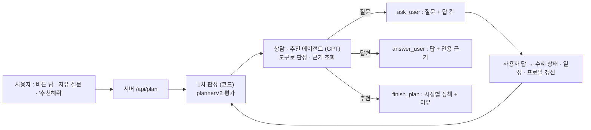

# 상담 · 추천 에이전트 재설계 (GPT)

> 2026-11-22 · 작성 : Claude Code (Jongeume 와 협의) · 상태 : **승인 (Jongeume, 11-22)**
> 저장소 `KCCI-Hackathon/gemini` · 기준 브랜치 `agent/planner-backend-link` (메인 화면 연결 MVP)
> 관련 : `2026-11-22 메인 화면 백엔드 연결 설계.md`, `01 팀 공유/11-22 메인 화면 연결 남은 문제.md`

**한 줄 요약 : 판정 코드는 기본 자격을 1차로 판정하고, 계획 에이전트를 GPT 로 바꿔 "더 물을 정보 판단 · 사용자 질문 답변 · 계획 추천"을 맡긴다. 새로 만들지 않고 지금의 `/api/plan` 에이전트를 고쳐 쓴다.**

---

## 1. 왜 하나

- 지금 꼬리 질문은 판정 코드가 고른다 (`Evaluation.questions`, 백엔드 `rankOpenQuestions`). 코드가 아는 질문만, 정해진 순서로 묻는다.
- 사용자가 궁금한 것을 직접 물을 길이 없다. 실사용자는 AI 가 꺼져 있고, 시연 인물도 정해진 문구만 보낸다.
- 추천은 규칙(시점마다 신청 가능 2개) 이거나, AI 가 옛 월 단위 로드맵 위에서 고른다.
- 목표 : 사용자가 원하는 정보를 얻도록, 에이전트가 **무엇을 더 물을지 스스로 판단**하고, **사용자 질문에 답하고**, **계획에 넣을 정책을 추천**한다. (Jongeume)
- 모델은 유료 GPT API 로 바꾼다. (Jongeume)

---

## 2. 목표 · 하지 않을 것 · 실패로 볼 것

| 구분 | 내용 |
|---|---|
| 목표 | 에이전트가 1차 판정을 보고 추가 정보가 필요한지 판단해 묻는다 (질문 후보 밖의 질문도, 답이 판정 입력으로 바뀔 수 있는 것이라면) |
| 목표 | 사용자가 자유롭게 쓴 질문에 답한다. 답은 판정 결과 · 공고 근거로만 한다 |
| 목표 | 계획에 넣을 정책을 시점별로 골라 이유와 함께 추천한다 |
| 목표 | 시연 인물은 자유 대화, 동의한 실사용자도 같은 기능 |
| 하지 않을 것 | 자격 판정을 AI 가 하지 않는다. 신청 가능 · 확인 필요 · 불가는 코드가 정한다 (원칙 "판정은 코드만" 유지) |
| 하지 않을 것 | 공고 근거 만들기(검증 에이전트 · 중복수혜 에이전트) 는 바꾸지 않는다. 계속 Gemini · 사람 승인 |
| 하지 않을 것 | 새 화면을 만들지 않는다. 메인 화면의 에이전트 패널 · AI 추천 경로 표시를 쓴다 |
| 실패로 볼 것 | AI 가 코드가 "불가"로 낸 정책을 추천하거나, "선정됩니다 · 받을 수 있어요" 처럼 판정을 바꿔 말한다 |
| 실패로 볼 것 | 답변에 판정 결과 · 공고 근거에 없는 날짜 · 금액 · 조건이 나온다 |
| 실패로 볼 것 | 동의하지 않은 실사용자의 정보나, 이름 · 연락처 · 주민번호 같은 식별 정보가 GPT 로 간다 |
| 실패로 볼 것 | AI 가 실패 · 시간 초과 · 비용 한도에 걸렸을 때 보드 · 담기 · 저장이 멈춘다 |

---

## 3. 접근 방식

| 방식 | 내용 | 선택 |
|---|---|---|
| **A. 기존 계획 에이전트 고쳐 쓰기** | `/api/plan` 의 도구 호출 루프를 유지하고, 모델 어댑터(OpenAI) 를 더하고, 도구를 새 화면 판정(`plannerV2`) 기준으로 바꾼다 | **채택 (Jongeume)** — 안전장치 · 캐시 · 시간 제한 · 시연 인물 확인을 그대로 쓰고, 제출 일정 안에 가능 |
| B. 상담 / 추천 에이전트로 쪼개기 | 질문 · 답변과 계획 추천을 다른 호출로 | 제외 — 호출 · 비용 · 연결 코드가 늘어난다 |
| C. 도구를 자유롭게 고르는 자율 에이전트 | 판정 다시 돌리기 · 공고 열기 등을 AI 가 직접 | 제외 — 비용 · 시간 예측이 어렵고 제출 전 테스트가 어렵다. A 의 도구를 그대로 넓히면 나중에 C 로 갈 수 있게 둔다 |

참고 : 지금 `/api/plan` 은 이미 "도구 호출 루프"다 (`get_route`, `rank_open_questions`, `get_policy_evidence`, `ask_user`, `parse_other_answer`, `finish_plan`). A 는 이 루프를 그대로 두고 도구 · 입력 · 모델을 바꾼다.

---

## 4. 역할 (새 설계)

| 역할 | 누가 | 하는 일 | 하지 않는 일 |
|---|---|---|---|
| **1차 판정** | 판정 코드 (`lib/judge`, `lib/planner/catalog.ts` · `evaluate.ts`) | 프로필 · 일정 · 수혜 상태로 정책 카드마다 신청 가능 / 확인 필요 / 불가, 사유, 근거, 신청 구간 · 내 기한, 중복수혜, "답하면 판정이 바뀌는 질문" 목록 | 사용자에게 말을 걸지 않는다 |
| **상담 · 추천 에이전트** (지금의 계획 에이전트, GPT) | `/api/plan` | ① 1차 판정을 보고 더 물을 정보를 고른다 ② 사용자 질문에 답한다 ③ 시점별 추천 정책과 이유를 고른다 | 판정을 바꾸지 않는다. 후보 밖 정책을 추천하지 않는다. 근거 밖 사실을 말하지 않는다 |
| **근거 만들기** (검증 · 중복수혜 에이전트, Gemini, 오프라인) | `lib/verify`, `scripts/overlap` | 공고 대조, 중복 제한 규칙 추출 → 사람 승인 | 바뀌지 않음 |

### 한 턴의 흐름

- 사용자가 답하면 답은 **구조화된 값**(프로필 칸 · 수혜 상태 · 일정)으로 바뀌어 코드가 다시 판정한다. AI 가 답을 들고 판정하지 않는다.

---

## 5. 에이전트 도구 (바꾼 뒤)

| 도구 | 내용 | 지금과 차이 |
|---|---|---|
| `get_evaluation` | 새 화면 판정 요약 : 시점(stage) 목록, 시점별 카드(정책 ID · 이름 · 판정 · 사유 코드 · 내 기한 · 검증 배지 · 담음 여부), 담은 정책 | 옛 `get_route`(월 단위 로드맵) 대신. 화면과 같은 판정을 본다 → 남은 문제 A-1(날짜 어긋남) 해소 |
| `get_policy_evidence` | 정책 · 시점별 사람이 확인한 조건 · 공고 인용 · 중복 제한 근거 | 근거에 `evidenceId` 를 붙인다 (답변 인용용) |
| `get_open_questions` | 코드가 낸 "답하면 판정이 바뀌는 질문"(`Evaluation.questions`) + 프로필의 빈 칸(상태 · 수료 예정 · 취업 예정 · 수혜) | 옛 `rank_open_questions` 확장 |
| `ask_user` | 질문 하나. **답이 들어갈 칸(`target`)** 을 반드시 지정 : 프로필 칸 · 일정 종류 · 수혜 정책 ID + 답 종류(`receiving` · `selected` · `ended_date` · `monthly_amount` · 날짜 · 선택지). 문장은 AI 가 쓰되, 선택지 · 입력 칸은 코드가 `target` 으로 붙인다 | 후보 목록 밖 질문도 허용. 단 `target` 이 판정 입력이 아니면 거절 |
| `answer_user` | 사용자 질문에 대한 답 + `citations`(evidenceId · 카드 offeringId 목록) | 새 도구. 인용이 없거나 판정 밖 내용이면 거절 |
| `finish_plan` | 시점별 추천 1~3개 + 이유 + 요약. 정책 대신 **카드(offeringId + stageId)** 로 고른다 | 대상이 옛 정거장 · 월 → 새 화면의 시점 · 카드. 남은 문제 A-1 · 설계 10장 "AI 추천 붙이기" 어긋남 해소 |
| `parse_other_answer` | 사용자가 버튼 대신 글로 답했을 때 `target` 값으로 바꾼다. 불확실하면 되묻기 | 시연 인물 정해진 문구 제한을 푼다 |
| `no_more_questions` | 그대로 | — |

### 코드가 지키는 선 (AI 응답 검사)

| 검사 | 걸리면 |
|---|---|
| `finish_plan` 의 카드가 지금 평가에 없거나 `blocked` | 그 항목 버림. 모두 버려지면 규칙 추천으로 대체 |
| `finish_plan` 에 `needs_check` 카드 | 허용하되 화면에 "확인 필요" 표시 유지 (판정은 코드 값 그대로) |
| `answer_user` 의 인용이 없거나 지금 판정 · 근거에 없는 ID | 답 버림 → "판정 결과에서 확인할 수 없는 내용이에요" |
| 답 · 이유 문장에 판정을 바꾸는 표현("선정됩니다", "받을 수 있어요" 등) · 근거에 없는 날짜 · 금액 | 기존 `guardResponse` 확장으로 버림 |
| `ask_user` 의 `target` 이 판정 입력이 아님 | 거절 → 에이전트가 다른 질문 |
| 한 요청의 도구 턴 · 토큰 · 시간 | 상한 넘으면 중단 → 규칙 추천 · 코드 질문으로 대체 (값은 6장) |

---

## 6. 모델 · 비용

| 항목 | 설계 |
|---|---|
| 어댑터 | `lib/ai/openai.ts` 새로. 지금 `gemini.ts` 처럼 에이전트 코드가 쓰는 요청 · 응답 모양(`AnthropicLike`)을 OpenAI 호출로 바꾼다. 에이전트 루프 · 도구 · 검사 코드는 공급자를 모른다 |
| 선택 | `AI_PROVIDER=openai`, `OPENAI_API_KEY`, `OPENAI_MODEL` (환경 변수). 상담 · 추천만 OpenAI, 검증 · 중복수혜 에이전트는 각자 설정대로 Gemini 유지 — 공급자를 에이전트별로 고를 수 있게 `PLAN_AI_PROVIDER` 를 따로 둔다 (Claude 판단) |
| 모델 이름 | 팀이 결제한 모델을 `OPENAI_MODEL` 로 정한다. 코드에 고정하지 않는다 |
| 비용 관리 | 요청당 도구 턴 · 출력 토큰 상한과 제공자 측 사용량·속도 제한을 적용한다. 앱 자체 일일 호출 횟수 제한은 두지 않는다. |
| 캐시 | 같은 판정 요약 · 같은 요청이면 그날 결과 재사용 (지금 방식). 자유 질문은 캐시하지 않는다 |
| 키 | 서버에서만. 화면에 보내지 않는다 |

---

## 7. 개인정보 (결정 : 시연 인물 + 동의한 실사용자)

| 대상 | 보내는 것 | 보내지 않는 것 | 조건 |
|---|---|---|---|
| 시연 인물 | 판정 요약 · 자유 질문 · 자유 답 전부 | — | 등록된 시연 인물과 일치 (`findRegisteredPersona`) |
| 실사용자 | 판정 요약(만 나이 범위 · 시군구 이름 · 학력 · 상태 · "N개월 뒤" · 수혜 정책 이름과 상태) + 자유 질문 · 자유 답 (식별 정보 지운 뒤) | 생년월일 원값 · 시군구 코드 · 정확한 날짜 · 이름 · 연락처 · 주민번호 · 계좌 같은 식별 정보 | `PLAN_AI_FOR_USERS=true` **그리고** 화면에서 "AI 상담 사용" 동의 |

- 식별 정보 지우기 : 서버 코드가 자유 입력에서 전화번호 · 주민번호 · 이메일 · 계좌번호 모양 문자열을 `[개인정보]` 로 바꾼 뒤 보낸다. 지운 것이 있으면 사용자에게 "개인정보로 보이는 부분은 빼고 보냈어요" 를 보여 준다.
- 동의 문구 : 어떤 정보가 OpenAI 로 가는지, 저장하지 않는다는 것, 언제든 끌 수 있다는 것.
- 팀 원칙 변경 : 기존 원칙 "실사용자 자유 입력은 외부 AI 로 보내지 않는다" 를 "동의 + 식별 정보 제거 뒤 보낸다" 로 바꾼다. **팀 합의와 운영사무국 허용 여부 확인이 필요하다** (10장).

---

## 8. 화면

| 자리 | 바뀌는 것 |
|---|---|
| 에이전트 패널 | 자유 입력창이 AI 로 간다 (지금은 일정 명령만 코드가 해석). 일정 명령("취업을 2월 13일로")은 지금처럼 코드가 먼저 해석하고, 명령이 아니면 AI 로 보낸다 |
| 질문 카드 | AI 가 고른 질문을 보여 준다. 답 칸은 `target` 에 맞춰 코드가 붙인다 (지금 질문 카드 재사용) |
| 답변 말풍선 | AI 답 + 인용한 근거(공고 문구 · 카드 링크) |
| AI 추천 경로 보기 | `finish_plan` 결과 (지금 표시 재사용) |
| 동의 | 실사용자가 처음 AI 를 쓸 때 동의 창. 동의 전에는 지금처럼 코드 질문 · 규칙 추천만 |
| 출처 표시 | AI 답 · 추천에는 "AI 정리" 표시, 대체될 때는 지금 문구 그대로 |

---

## 9. 완료 조건 (테스트)

| 번호 | 입력 | 기대 결과 |
|---|---|---|
| G1 | 시연 인물, 수혜 상태 없음, "나에게 맞는 경로 추천해줘" | 에이전트가 먼저 판정을 바꿀 질문 1개를 묻거나(`ask_user` + `target`), 바로 `finish_plan`. 추천 카드는 모두 지금 평가에 있고 `blocked` 아님 |
| G2 | 시연 인물 자유 질문 "청년도전지원사업은 왜 확인 필요예요?" | `answer_user` 답에 그 카드 사유와 근거 인용. 근거에 없는 날짜 · 금액 없음 |
| G3 | 모의 모델이 `blocked` 카드를 추천 | 그 항목 버림, 나머지 표시 · 모두 버려지면 규칙 추천 |
| G4 | 모의 모델이 인용 없는 답 | 답 버림 + 안내 문구 |
| G5 | 동의 안 한 실사용자 · `PLAN_AI_FOR_USERS` 꺼짐 | GPT 호출 0회, 코드 질문 · 규칙 추천 |
| G6 | 실사용자 자유 질문에 "010-1234-5678" | 보낸 본문에 번호 없음 (`[개인정보]`) + 안내 |
| G7 | 모델 시간 초과 · 429 · 503 · 비용 상한 | 규칙 추천 · 코드 질문으로 대체, 보드 · 담기 · 저장 정상 |
| G8 | `ask_user` 답(예 : 국민취업지원제도 받는 중) | 수혜 상태 갱신 → 코드 재판정 → 청년도전지원사업 `blocked` |
| G9 | OpenAI 어댑터 | 도구 호출 요청 · 응답 변환 단위 테스트 (실호출 없이) |
| G10 | 기존 테스트 | 전부 통과 |

---

## 9.1 결정 (Jongeume, 11-22)

| 결정 | 내용 |
|---|---|
| 작업 순서 | 이 작업은 `agent/planner-backend-link` 위에서 한다. (처음엔 J-1 · A-1 · A-2 를 이 작업으로 가져오기로 했으나, 같은 날 20시대에 팀이 PR #3 · #4 · #6 으로 남은 문제 J · F · A 전부를 이미 고쳐 머지했다. 그래서 그 결과 위에서 시작한다) |
| 팀 수정과 맞출 점 | 질문 형식은 J-1 · J-7 이 만든 것을 따른다 : 백엔드 `Restriction.need` (질문 종류), `BenefitQuestion.month` (지급 월). `ask_user` 의 `target` 은 이 형식을 프로필 · 일정 칸까지 넓힌 것이다. A-1 의 "화면 일정이 월 격자에 안 맞으면 규칙 추천" 은 새 형식(`version: 2`)이 정확한 날짜를 받으면서 대신한다. A-2 의 질문 순서 · "나중에 답할게요" 는 그대로 쓴다 |
| AI 호출 시점 | 사용자가 메시지를 보내거나 "추천해줘"를 누를 때만 부른다. AI 가 질문한 경우에만 답한 뒤 자동으로 한 번 더 부르고, 연속 자동 호출은 3번까지. 그 밖에는 코드 질문 카드(`Evaluation.questions`)를 보여 준다 |

---

## 10. 남은 결정

| 결정 | 누가 | 영향 |
|---|---|---|
| 실사용자 자유 입력을 GPT 로 보내는 원칙 변경 · 운영사무국 허용 | 팀 | 안 되면 7장의 실사용자 줄을 끄고 시연 인물만 |
| 쓸 GPT 모델 이름 | 팀 (결제한 모델) | `OPENAI_MODEL` 값 |
| 비용 상한 숫자 (요청당 턴 · 토큰, 하루 횟수) | 팀 | 6장 |

---

## 10.1 Claude 판단으로 정한 것 (구현자 시점 검토에서 나옴, 확인 필요)

| 질문 | 정한 것 | 이유 |
|---|---|---|
| 대화 상태는 어디에? | 서버는 지금처럼 상태를 남기지 않는다. 화면이 최근 대화 6턴(질문 · 답 · AI 응답 요약)을 요청에 실어 보낸다. 식별 정보 지우기는 이 이력에도 똑같이 적용한다. 자유 질문 · 이력이 있는 요청은 캐시하지 않는다 | 서버 저장소 없이 지금 배포 구조(Vercel) 그대로 간다 |
| AI 가 질문하고 사용자가 답한 뒤 | 화면이 재판정한 다음 에이전트를 자동으로 한 번 더 부른다. 연속 자동 호출은 3번까지, 그 뒤엔 사용자가 다시 누를 때 | G1 흐름(물어보고 → 추천)을 끊지 않되 비용을 묶는다 |
| 시연 인물이 답하면 시연 인물에서 빠진다 (`findRegisteredPersona` 는 상태 · 일정까지 비교) | 시연 인물 확인은 **`demoId` + 기본 칸(생년월 · 시군구 · 학력 · source) 만** 비교한다. 상태 · 일정 · 수혜는 답으로 바뀌어도 된다. 기본 칸이 바뀌면 시연 인물이 아니다 | 에이전트가 묻고 답을 받는 것이 목적이라 상태 · 일정이 바뀌는 게 정상이다. 남은 문제 A-1 도 같이 풀린다 |
| `ask_user` 가 쓸 수 있는 칸 | 프로필 : 현재 상태 · 최근 취업 · 훈련 이력. 일정 : 수료 · 취업 · 창업 · 이사 예정일. 수혜 : 승인 규칙의 원인 정책의 상태 · 마지막 지급일 · 월 지급액. 생년월 · 시군구 · 학력은 묻지 않는다 (프로필 편집으로만) | 기본 칸은 시연 인물 확인과 개인정보에 걸린다 |
| 실사용자에게 보내는 날짜 | 공고의 공식 접수일 · 마감일(공개 정보)은 그대로. 사용자 일정 · 개인 기한은 "오늘부터 N일 뒤" 로 바꿔 보낸다. 날짜 · 금액 검사는 AI 에게 보낸 값(공식 날짜 · N일 · 근거 금액) 기준 | 개인 일정이 정확한 날짜로 나가지 않으면서 "왜 기한이 빠른지" 는 답할 수 있다 |
| 추천 이유 문장 | AI 의 `why` 를 검사(판정 표현 · 근거 밖 날짜 · 금액) 통과한 경우 보여 준다. 옆에 코드 판정(신청 가능 / 확인 필요) 과 내 기한을 늘 같이 보여 준다. 검사에 걸리면 지금처럼 코드 문장 | 에이전트가 판단한 이유를 보여 주는 게 이번 목적. 판정은 코드 값이 함께 있어 바뀌지 않는다 |
| 옛 `/api/plan` 형식 (`app/legacy/page.tsx` 가 씀) | 옛 형식은 그대로 받는다. 새 형식은 요청에 `version: 2` 를 붙여 구분한다. 옛 테스트는 그대로 둔다 | legacy 화면 · 기존 테스트를 깨지 않는다 |

---

## 11. 구현자에게 맡기는 것

- OpenAI 호출 방식(함수 호출 · 구조화 출력) 세부와 어댑터 내부
- 식별 정보 패턴의 정규식 세부
- 동의 창 · 답변 말풍선의 배치 (기존 디자인 토큰 안에서)
